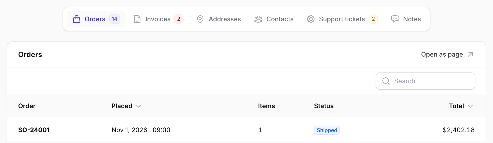

# Relation Navigator لـ Filament

<p class="filament-hidden">
    <a href="https://packagist.org/packages/wit3/filament-relation-navigator"></a>
    <a href="https://github.com/wit3/filament-relation-navigator/actions/workflows/tests.yml"></a>
    <a href="https://packagist.org/packages/wit3/filament-relation-navigator"></a>
    <a href="LICENSE.md"></a>
</p>

> **التوثيق:** الأدلة، ومرجع الإعدادات، ودليل الترقية، والبحث على
> **[wit3.github.io/filament-relation-navigator/ar](https://wit3.github.io/filament-relation-navigator/ar/)**.
>
> **أحدث إصدار:** [ما الجديد](https://wit3.github.io/filament-relation-navigator/ar/reference/changelog) [](https://github.com/wit3/filament-relation-navigator/releases/latest)
>
> **بلغات أخرى:** التوثيق بـ
> [English](https://wit3.github.io/filament-relation-navigator/) (الأصل) · [Italiano](https://wit3.github.io/filament-relation-navigator/it/) · [Español](https://wit3.github.io/filament-relation-navigator/es/) · [Português](https://wit3.github.io/filament-relation-navigator/pt/) · [Français](https://wit3.github.io/filament-relation-navigator/fr/) · [Deutsch](https://wit3.github.io/filament-relation-navigator/de/) · [中文](https://wit3.github.io/filament-relation-navigator/zh/) · [日本語](https://wit3.github.io/filament-relation-navigator/ja/) · [Русский](https://wit3.github.io/filament-relation-navigator/ru/).
> لكل لغة أيضًا ملف README خاص بها في هذا المستودع (`README.md`، `README.it.md`...).

<!-- #region intro -->
امنح كل relation manager في resource من Filament **صفحة خاصة به**، وتنقّل
بينها من **قائمة في مسار التنقل (breadcrumb)**.

- يصبح `/customers/1?relation=orders` هو **`/customers/1/orders`**: مسار
  حقيقي يمكنك الربط إليه وحفظه في المفضلة وفتحه في تبويب جديد.
- تعرض الصفحة **الـ relation manager الموجود لديك أصلًا**: الجدول نفسه،
  والفلاتر والإجراءات والشارات والصلاحيات نفسها. لا شيء مكرر.
- أضف **ترويسة** فوق العلاقة (بطاقة السجل، widgets، إجراءات)، مأخوذة من
  الـ resource.
- يفتح آخر عنصر في مسار التنقل **قائمة** فيها صفحات السجل وكل علاقة يستطيع
  المستخدم رؤيتها، مع الأيقونات والشارات. شكلان، وبحث اختياري وتنقل بلوحة
  المفاتيح، وقالب من عندك، ونسخة للشاشات الصغيرة.
- **السجل السابق والتالي** في الصفحة نفسها، وإجراء **«فتح كصفحة»** في كل
  جدول relation manager، وروابط التبويبات القديمة التي توصل إلى الصفحات
  الجديدة: يمكن تشغيل كل منها وإيقافه على المستوى العام، أو لكل resource، أو
  لكل صفحة.
- **يكفي trait واحد، بلا أصناف صفحات**: لا ملفات لتوليدها، ولا شيء تضيفه إلى
  `getPages()` أو إلى الـ panel provider.
- **32 لغة**، بما فيها اللغات التي تُكتب من اليمين إلى اليسار، بنفس رموز Filament. والتوثيق متاح بـ 10 لغات.


<!-- #endregion intro -->

## المتطلبات

<!-- #region requirements -->
| الحزمة   | الإصدار              |
| -------- | -------------------- |
| PHP      | 8.2+                 |
| Laravel  | 12, 13               |
| Filament | 4.13+, 5.x           |
<!-- #endregion requirements -->

## التثبيت

<!-- #region installation -->
```bash
composer require wit3/filament-relation-navigator
php artisan filament:assets
```

شغّل `filament:assets` مرة أخرى بعد كل تحديث: ينسخ Filament ملف أنماط
الإضافة (stylesheet) إلى `public/`.
<!-- #endregion installation -->

## البدء السريع

<!-- #region quick-start -->
**1. امنح العلاقات صفحة.** أضف الـ trait إلى الـ resource:

```php
use Wit3\FilamentRelationNavigator\Concerns\HasRelationPages;

class CustomerResource extends Resource
{
    use HasRelationPages;

    public static function getRelations(): array
    {
        return [
            'orders' => OrdersRelationManager::class,
            'invoices' => InvoicesRelationManager::class,
            NotesRelationManager::class,
        ];
    }
}
```

أصبح لكل علاقة الآن صفحتها: `/customers/1/orders` و`/customers/1/invoices`
و`/customers/1/notes`.

**2. أضف القائمة إلى صفحة العرض:**

```php
use Wit3\FilamentRelationNavigator\Concerns\HasRelationNavigator;

class ViewCustomer extends ViewRecord
{
    use HasRelationNavigator;
}
```

هذا كل شيء. صفحات العلاقات فيها القائمة مسبقًا، وتبقى التبويبات في صفحة
العرض تعمل كما كانت.

<picture>
    <source media="(prefers-color-scheme: dark)" srcset="https://raw.githubusercontent.com/wit3/filament-relation-navigator/main/art/relation-page-dark.png">
    
</picture>
<!-- #endregion quick-start -->

## صفحات العلاقات

<!-- #region relation-pages -->
### التفعيل

فعّل الصفحات على الـ resource لكل الـ relation managers، أو فقط على
الـ relation managers التي تريدها:

```php
use Wit3\FilamentRelationNavigator\Concerns\InteractsWithRelationPage;

class OrdersRelationManager extends RelationManager
{
    use InteractsWithRelationPage;
}
```

| الإعداد                                     | العلاقات التي لها صفحة              |
| ------------------------------------------- | ----------------------------------- |
| `HasRelationPages` على الـ resource         | كلها، ما عدا المستبعدة              |
| `InteractsWithRelationPage` على relation manager | فقط الـ relation managers التي تستخدمه |
| صنف صفحة كتبته بنفسك (انظر أدناه)           | كلها، ما عدا المستبعدة              |

لاستبعاد بعض العلاقات:

```php
// على الـ resource
public static function hasRelationPage(string $slug): bool
{
    return $slug !== 'notes';
}

// على relation manager، مع InteractsWithRelationPage
protected static bool $hasRelationPage = false;
```

الـ relation manager المشترك بين resource وآخر يُفعَّل في الاثنين: استخدم
`hasRelationPage()` في الـ resource لاستبعاد أحدهما.

### عناوين URL والـ slugs

| مدخل في `getRelations()`                        | URL                         |
| ----------------------------------------------- | --------------------------- |
| `'orders' => OrdersRelationManager::class`      | `/customers/1/orders`       |
| `SupportTicketsRelationManager::class` (بلا مفتاح) | `/customers/1/support-tickets` |
| `RelationGroup::make('Activity', [...])`        | `/customers/1/activity`     |

يفوز الـ slug الذي يحدده الـ relation manager نفسه
(`protected static ?string $relationPageSlug = 'tickets';`)، ثم المفتاح في
`getRelations()`، ثم اسم العلاقة بصيغة kebab-case (أو تسمية المجموعة: أعطِ
المجموعات مفتاحًا، لأن التسمية المترجمة تتغير مع اللغة). تُتخطى الـ slugs
المطابقة لأحد مفاتيح صفحات الـ resource (`edit`، `view`...)، وكذلك العلاقة
الثانية التي يكون الـ slug الخاص بها مأخوذًا مسبقًا.

كل صفحة مسار مسمى (named route)، `relations.{slug}`:

```php
CustomerResource::getUrl('relations.orders', ['record' => $customer]);
```

### الصلاحيات والسلوك

يتلقى الـ relation manager صفحة **العرض** الخاصة بالـ resource على أنها
`$pageClass` (أو صفحة التعديل إن لم توجد صفحة عرض)، لذلك تعمل
`isReadOnly()` و`canViewForRecord()` و`getBadge()` وكل الفحوص الأخرى تمامًا
كما في التبويب. يُعثر على صفحة العرض بمفتاحها (`view` أو `edit` أو
`$contextPage` في صنف صفحة كتبته بنفسك) أو بصنفها.

تحتاج صفحة العلاقة إلى ما تحتاجه صفحة العرض (دالة `canAccess()` الخاصة بها
وسياسة `view` للسجل؛ و`update` عندما تقوم مقام صفحة التعديل) وإلى
`canViewForRecord()` الخاصة بالـ relation manager. من دون صفحة عرض أو صفحة
تعديل، تُطبَّق سياسة `view`. السياسة التي ترفض الوصول على أنه «غير موجود»
تعطي 404، وكذلك الـ slug غير المعروف. القائمة والبحث العام و«فتح كصفحة» لا
تربط إلا بالصفحات التي يستطيع المستخدم فتحها.

لا تنفذ صفحات العلاقات الشيفرة الخاصة بصفحة العرض: الفحوص الموجودة في
`authorizeAccess()` الخاصة بها، أو `getRelationManagers()` المفلترة حسب
المستخدم، لا تُطبَّق هناك. ضعها في السياسات (policies)، أو في
`canViewForRecord()`، أو امنع صفحة علاقة لكل سجل على حدة من الـ resource:

```php
public static function canAccessRelationPage(Model $record, string $slug): bool
{
    return $slug !== 'audit-logs' || auth()->user()->isAdmin();
}
```
<!-- #endregion relation-pages -->

## الترويسة والإجراءات والـ widgets

<!-- #region header-actions-and-widgets -->
فوق العلاقة، يمكن أن تعرض صفحة العلاقة جزءًا من عرض السجل، وإجراءات في
الترويسة، و widgets. عرّفها على الـ resource لكل صفحات العلاقات، أو على
relation manager لصفحته فقط:

<picture>
    <source media="(prefers-color-scheme: dark)" srcset="https://raw.githubusercontent.com/wit3/filament-relation-navigator/main/art/relation-page-dark.png">
    
</picture>

```php
public static function relationPageHeader(Schema $schema): Schema
{
    // الـ infolist كاملة (static::infolist($schema)) أو جزء منها.
    return $schema->components([
        CustomerCard::make(),
    ]);
}

public static function getRelationPageHeaderActions(): array
{
    return [
        Action::make('email')
            ->url(fn (Customer $record): string => "mailto:{$record->email}"),
    ];
}

public static function getRelationPageHeaderWidgets(): array
{
    return [CustomerStats::class]; // تتلقى السجل في $record
}

public static function getRelationPageFooterWidgets(): array
{
    return [];
}
```

- ترويسة الـ relation manager تحل محل ترويسة الـ resource؛ أما الإجراءات
  والـ widgets فتُعرض من الاثنين، وتلك الخاصة بالـ resource أولًا.
- تعمل إجراءات الترويسة على السجل الذي تنتمي إليه العلاقة.
- عند وجود ترويسة، لا يتكرر اسم السجل تحت العنوان.
- الأجزاء الموجودة داخل صنف صفحة العرض فقط (دوالها ونوافذها المنبثقة) لا يمكن
  الوصول إليها من هنا: انقلها إلى الـ resource، أو إلى صنف إجراء، أو إلى
  trait.
<!-- #endregion header-actions-and-widgets -->

## قائمة مسار التنقل

<!-- #region the-breadcrumb-menu -->
يحتاج `HasRelationNavigator` إلى صفحة لها سجل: لدى `ViewRecord` و`EditRecord`
والصفحات التي تستخدم `InteractsWithRecord` مسبقًا الدالتان اللتان يعلنهما،
`getRecord()` و`hasRecord()`. في صفحة بلا سجل، ينبهك PHP إلى ذلك فور تحميل
الصنف.

تظهر صفحة السجل في القائمة إذا، وفقط إذا، كانت تستخدم `HasRelationNavigator`:
صفحة العرض أو صفحة التعديل أو أي صفحة مخصصة للسجل. في تلك الصفحات يفتح آخر
عنصر في مسار التنقل القائمة. صفحات العلاقات مدرجة دائمًا، بعد صفحات السجل،
مع أيقونات الـ relation managers وشاراتها، وفقط عندما يستطيع المستخدم
رؤيتها.

إذا كانت الصفحة تبني عناصر مسار التنقل بنفسها، فمررها عبر
`withRelationNavigator()`:

```php
public function getBreadcrumbs(): array
{
    return $this->withRelationNavigator([
        CustomerResource::getUrl('index') => 'Customers',
        $this->getBreadcrumb(),
    ]);
}
```

الصفحة المخصصة التي تستخدم `InteractsWithRecord` بنفسها، بدلًا من توسيع
`ViewRecord` أو `EditRecord`، تصبح لديها دالتان `getBreadcrumbs()`. ما لم
تعرّف دالتها الخاصة، أخبر PHP أيهما تفوز:

```php
class CustomerActivity extends Page
{
    use HasRelationNavigator, InteractsWithRecord {
        HasRelationNavigator::getBreadcrumbs insteadof InteractsWithRecord;
        InteractsWithRecord::getBreadcrumbs as getRecordBreadcrumbs;
    }
}
```

تستخدم القائمة `$navigationLabel` و`$navigationIcon` الخاصين بالصفحة، ولا
تعرضها إلا عندما يسمح بذلك `canAccess()` لذلك السجل.
<!-- #endregion the-breadcrumb-menu -->

## فتح كصفحة

<!-- #region open-as-page -->
في صفحتي العرض والتعديل، يحصل كل relation manager له صفحة خاصة على إجراء
**فتح كصفحة** في ترويسة جدوله، بجوار عنوانه وقبل إجراءاته الخاصة. يفتح
الإجراء صفحة الـ relation manager الخاصة، أو صفحة مجموعة العلاقات التي ينتمي
إليها إذا لم تكن له صفحة خاصة. في صفحة المجموعة، تحصل الـ relation managers
التي لها صفحات خاصة على الإجراء أيضًا؛ وفي صفحته الخاصة لا يربط
الـ relation manager إلى نفسه أبدًا.

<picture>
    <source media="(prefers-color-scheme: dark)" srcset="https://raw.githubusercontent.com/wit3/filament-relation-navigator/main/art/open-as-page-dark.png">
    
</picture>

أوقفه حيث تحتاج:

```php
// config/filament-relation-navigator.php: في كل مكان
'relation_manager_link' => false,
```

```php
// على resource: كل الـ relation managers التابعة له
public static function hasRelationPageLinks(): bool
{
    return false;
}
```

```php
// على relation manager (مع InteractsWithRelationPage)
protected static bool $hasRelationPageLink = false;

// أو، من دون الـ trait
public static function hasRelationPageLink(): bool
{
    return false;
}
```

### مظهره

رابط مع سهم افتراضيًا. غيّره في الإعدادات:

```php
'relation_manager_action' => [
    'style' => 'button',        // link أو button أو icon_button (تصبح التسمية تلميحًا)
    'label' => 'صفحة كاملة',    // نص أو مفتاح ترجمة؛ null: «فتح كصفحة»، مترجمًا
    'icon' => 'heroicon-m-arrow-top-right-on-square', // أي أيقونة من Filament، أو null
    'icon_position' => 'after', // أو before
    'color' => 'gray',
    'size' => null,             // sm، md، lg...
    'new_tab' => false,
],
```

أو غيّر إجراء Filament نفسه، في كل شيء ما عدا رابطه ومتى يظهر، وهما ما
تحدده الحزمة. يتلقى كل مستوى الإجراء كما تركه المستوى السابق:

```php
// مزود خدمة (service provider): كل الـ relation managers
RelationNavigator::configureRelationPageActionUsing(
    fn (Action $action, RelationManager $relationManager) => $action->outlined()->badge('جديد'),
);
```

```php
// resource أو relation manager: هناك فقط
public static function configureRelationPageAction(Action $action): Action
{
    return $action->iconButton()->tooltip('افتح الطلبات في صفحتها الخاصة');
}
```

للحصول على الرابط نفسه في زر من عندك، استخدم
`RelationNavigator::getRelationManagerPageUrl($relationManager)`.
<!-- #endregion open-as-page -->

## السجل السابق والتالي

<!-- #region previous-and-next-record -->
يفتح زران قبل إجراءات الترويسة السجل السابق أو التالي **في الصفحة نفسها**:
من فواتير عميل إلى فواتير العميل التالي.


السجل الذي لا يمكنه فتح تلك الصفحة يُفتح على أول صفحة له في القائمة. الزران
معطلان افتراضيًا، لأنهما يضيفان بضعة استعلامات في كل عرض للصفحة:

```php
'record_navigation' => true,
```

يتبعان **قائمة السجلات التي جاء منها المستخدم**: ترتيبها وفلاترها وبحثها
وتبويبها، كما تظهر على الشاشة (حتى 100 سجل؛ نحو 30 مع مفاتيح UUID). عند أول
سجل أو آخر سجل في تلك القائمة يتوقف التنقل، بدلًا من القفز إلى ترتيب آخر.
السجل غير الموجود في القائمة (المفتوح من رابط) يُتنقل منه حسب المفتاح. للتنقل
حسب المفتاح دائمًا:

```php
'record_navigation_follows_list' => false,
```

لا تحفظ صفحة القائمة سجلاتها إلا عندما يكون التنقل بين السجلات مفعلًا في
الإعدادات أو على الـ resource (`hasRelationNavigatorRecordNavigation()`)، لأن
صفحة القائمة لا يمكنها سؤال صفحة السجل.

يتنقلان عبر استعلام الـ resource نفسه (`getRecordRouteBindingEloquentQuery()`)،
فتُطبَّق الـ tenancy والـ scopes الخاصة بك، ويتخطيان السجلات التي لا يستطيع
المستخدم عرضها. لكل صفحة:

```php
public function hasRelationNavigatorRecordNavigation(): bool
{
    return true;
}

public function getRelationNavigatorRecordNavigationQuery(): ?Builder
{
    return Customer::query()->where('active', true);
}
```

في **resource متداخل** (nested resource) يبقيان ضمن السجل الأب: من أحد طلبات
عميل إلى الطلب التالي للعميل نفسه. قائمة السجلات هناك هي الـ relation manager
الخاص بالأب: يتبعان ترتيبه عندما يكون الـ resource المتداخل هو الـ related
resource الخاص به (`protected static ?string $relatedResource`)، إلا مع مشغل
الجلسات `cookie`، الذي يحتفظ بقائمة الأب فقط.
<!-- #endregion previous-and-next-record -->

## روابط تبويبات الـ relation managers

<!-- #region links-to-relation-manager-tabs -->
بعد أن تحل صفحات العلاقات محل التبويبات، يمكن للروابط القديمة مثل
`/customers/1?relation=orders` أن تفتح `/customers/1/orders` بدلًا منها:

```php
'redirect_relation_tabs' => true,
```

التبويبات التي ليست لها صفحة علاقة، أو التي لا يستطيع السجل رؤيتها، تبقى في
مكانها.
<!-- #endregion links-to-relation-manager-tabs -->

## البحث العام

<!-- #region global-search -->
يمكن لنتائج البحث العام أن تربط مباشرة بصفحات علاقات السجل: ابحث عن عميل،
وانتقل إلى طلباته. الميزة معطلة افتراضيًا، لأنها تشغّل `canViewForRecord()`
الخاصة بالـ relation managers لكل نتيجة:

<picture>
    <source media="(prefers-color-scheme: dark)" srcset="https://raw.githubusercontent.com/wit3/filament-relation-navigator/main/art/global-search-dark.png">
    
</picture>

```php
// config/filament-relation-navigator.php
'global_search_actions' => 3, // true لكل الروابط، أو الحد الأقصى للروابط في كل نتيجة
```

```php
// على resource: مفعلة أو معطلة لهذا الـ resource فقط
public static function hasRelationPageGlobalSearchActions(): bool
{
    return true;
}
```

```php
// على relation manager (مع InteractsWithRelationPage): لا يُربط أبدًا
protected static bool $hasRelationPageGlobalSearchAction = false;
```

تحصل الـ resources التي تستخدم `HasRelationPages` على الروابط تلقائيًا. أما
الـ resource الذي يعرّف `getGlobalSearchResultActions()` بنفسه، أو الذي يفعّل
الصفحات من الـ relation managers فقط، فيدمجها هكذا:

```php
public static function getGlobalSearchResultActions(Model $record): array
{
    return [
        // ...إجراءاتك
        ...RelationNavigator::getGlobalSearchResultActions(static::class, $record),
    ];
}
```

تتبع الروابط قواعد القائمة نفسها: صفحات العلاقات التي يستطيع المستخدم فتحها
فقط.
<!-- #endregion global-search -->

## أنماط القائمة

<!-- #region menu-presets -->
انشر ملف الإعدادات:

```bash
php artisan vendor:publish --tag=filament-relation-navigator-config
```

```php
'menu' => [
    'preset' => 'github',   // 'simple'، أو نمط من عندك، أو اسم قالب
    'presets' => [
        'simple' => 'filament-relation-navigator::menu.simple',
        'github' => 'filament-relation-navigator::menu.github',
    ],
    'searchable' => true,   // حقل بحث أعلى القائمة، أيًا كان النمط
    'search_from' => 0,     // ...ابتداء من هذا العدد من العناصر
    'badges' => 'lazy',     // شارات الـ relation managers: 'lazy' عند فتح القائمة، true مع الصفحة، false معطلة
    'max_height' => '24rem',
    'separator' => true,    // صفحات السجل وصفحات العلاقات في كتلتين
    'mobile' => true,       // القائمة فوق عنوان الصفحة في الشاشات الصغيرة
    'shortcut' => 'alt+shift+r', // يفتح القائمة؛ null يعطله
],
```

النمط **github** (الافتراضي): يبقى آخر عنصر في مسار التنقل نصًا، ويفتح سهم
صغير بجانبه لوحة فيها عنوان وحقل بحث وعلامة على الصفحة الحالية، مثل مبدّل
المستودعات في GitHub. يحصل الحقل على التركيز عند فتح القائمة، ويفتح Enter أول
نتيجة مطابقة.

النمط **simple**: آخر عنصر في مسار التنقل نفسه هو الذي يفتح القائمة. للحصول
على قائمة الإصدار 1.2 وما قبله، اضبط `'preset' => 'simple'` و
`'searchable' => false`.

<picture>
    <source media="(prefers-color-scheme: dark)" srcset="https://raw.githubusercontent.com/wit3/filament-relation-navigator/main/art/menu-simple-dark.png">
    
</picture>

### الشارات

تعرض القائمة شارات الـ relation managers، كما في تبويباتها. افتراضيًا
**تُحمَّل عند فتح القائمة**: تبقى القائمة مغلقة حتى ذلك الحين، فتُعرض الصفحة
من دون استعلامات الشارات، وكذلك في كل طلب Livewire يعيد رسم مسار التنقل. يظهر
مؤشر تحميل خلال اللحظة التي تستغرقها.

```php
'badges' => 'lazy', // الافتراضي؛ true: مع الصفحة؛ false: بلا شارات
```

أوقفها حيث تحتاج:

```php
// صفحة، أو resource (static): بلا شارات في هذه القائمة
public function hasRelationNavigatorBadges(): bool
{
    return false;
}

// relation manager (مع InteractsWithRelationPage): تبقى شارته في
// التبويب، لا في القائمة
protected static bool $hasRelationNavigatorBadge = false;
```

الـ relation manager الذي تكون شارة تبويبه مؤجلة التحميل (lazy) في Filament
(`protected static ?bool $isBadgeLazyLoaded = true;`، أو `$isBadgeDeferred` في
Filament 4.13) تكون شارته مؤجلة في القائمة أيضًا، حتى مع `'badges' => true`.

قوالب القائمة التي لا تستطيع تحميل الشارات لاحقًا (قوالب الحزمة المنشورة قبل
1.3، أو أنماطك الخاصة التي تعرض `$item->badge` بنفسها) تحصل عليها مع الصفحة،
كما في السابق: لا شيء يختفي.

**لوحة المفاتيح**: من حقل البحث، ينقلك السهم للأسفل إلى القائمة؛ ويتنقل
السهمان للأعلى وللأسفل بين الصفحات، ويفتح Enter إحداها، ويغلق Escape القائمة.

### الاختصار والتلميح

<picture>
    <source media="(prefers-color-scheme: dark)" srcset="https://raw.githubusercontent.com/wit3/filament-relation-navigator/main/art/tooltip-dark.png">
    
</picture>

للزر الذي يفتح القائمة تلميح يعرض الاختصار، بمفاتيح Mac أو Windows/Linux.
يفتح الاختصار القائمة من أي مكان في الصفحة، مع حقل البحث جاهزًا، مثل مبدّل
المستودعات في GitHub: <kbd>⌥</kbd> <kbd>⇧</kbd> <kbd>R</kbd> على Mac، و
<kbd>Alt</kbd> <kbd>Shift</kbd> <kbd>R</kbd> في غيره. غيّره في الإعدادات أو
لكل صفحة:

```php
'shortcut' => 'mod+shift+p', // mod هو ⌘ على Mac و Ctrl في غيره
```

```php
public function getRelationNavigatorShortcut(): ?string
{
    return null; // لا اختصار في هذه الصفحة
}
```

صُمم كي لا يعترض طريقك:

- يطابق المفتاح الفعلي، فيعمل مع أي تخطيط للوحة المفاتيح ومع Option على Mac
  (حيث تكتب <kbd>⌥</kbd><kbd>⇧</kbd><kbd>R</kbd> الرمز ‰)؛
- لا يفعل شيئًا أثناء الكتابة في حقل؛
- لا يأخذ أبدًا اختصارًا يستخدمه البحث العام في الـ panel
  (`globalSearchKeyBindings()`): عندها تبقى القائمة بلا اختصار؛
- لا تُفتح إلا القائمة الظاهرة (في مسار التنقل أو في الشاشات الصغيرة).

المفاتيح المدعومة: `alt` و`shift` و`ctrl` و`meta` و`mod` مع حرف أو رقم أو
`/ . , ;`.

<picture>
    <source media="(prefers-color-scheme: dark)" srcset="https://raw.githubusercontent.com/wit3/filament-relation-navigator/main/art/menu-github-search-dark.png">
    
</picture>

### الصفحة ثم resource ثم config

لكل خيار ثلاثة مستويات. تفوز الصفحة، ثم الـ resource، ثم ملف الإعدادات
(config):

| دالة الصفحة (static على الـ resource) | مفتاح الإعدادات |
|---|---|
| `getRelationNavigatorPreset(): string` | `menu.preset` |
| `isRelationNavigatorSearchable(): bool` | `menu.searchable` |
| `hasRelationNavigatorBadges(): bool` | `menu.badges` |
| `hasDeferredRelationNavigatorBadges(): bool` | `menu.badges` = `'lazy'` |
| `getRelationNavigatorShortcut(): ?string` | `menu.shortcut` |
| `hasRelationNavigatorMobileMenu(): bool` | `menu.mobile` |
| `hasRelationNavigatorRecordNavigation(): bool` | `record_navigation` |
| `shouldRelationNavigatorRecordNavigationFollowList(): bool` | `record_navigation_follows_list` |
| `shouldRedirectRelationNavigatorTabs(): bool` | `redirect_relation_tabs` |

```php
// على صفحة واحدة
public function isRelationNavigatorSearchable(): bool
{
    return false;
}
```

```php
// على resource: الدالة نفسها، static، لكل صفحاته
public static function hasRelationNavigatorRecordNavigation(): bool
{
    return true;
}
```

### الشاشات الصغيرة

يخفي Filament مسار التنقل تحت عرض 40rem. هناك تظهر القائمة فوق عنوان الصفحة
بدلًا من ذلك، في كل صفحة تستخدم `HasRelationNavigator`، بخيارات النمط نفسها.
أوقفها بـ `'mobile' => false`، أو لكل صفحة:

```php
public function hasRelationNavigatorMobileMenu(): bool
{
    return false;
}
```

<picture>
    <source media="(prefers-color-scheme: dark)" srcset="https://raw.githubusercontent.com/wit3/filament-relation-navigator/main/art/mobile-dark.png">
    
</picture>

### الترجمات

32 لغة، بالرموز نفسها التي يستخدمها Filament: الألمانية، والإسبانية،
والإندونيسية، والإنجليزية، والأوكرانية، والإيطالية، والبرتغالية (البرتغال
والبرازيل)، والبلغارية، والبولندية، والتركية، والتشيكية، والدنماركية،
والروسية، والرومانية، والسلوفاكية، والسويدية، والصينية (المبسطة والتقليدية)،
والعبرية، والعربية، والفارسية، والفرنسية، والفنلندية، والفيتنامية،
والكاتالونية، والكورية، والمجرية، والنرويجية، والهولندية، واليابانية،
واليونانية. في اللغات التي تُكتب من اليمين إلى اليسار ينعكس اتجاه سهمي السابق
والتالي. انشر الترجمات لتغييرها أو لإضافة لغة:

```bash
php artisan vendor:publish --tag=filament-relation-navigator-translations
```

### نمط خاص بك

ابدأ من أحد أنماط الحزمة:

```bash
php artisan make:filament-relation-navigator-preset compact --from=github
```

ينسخ الأمر النمط إلى
`resources/views/filament/relation-navigator/compact.blade.php`. سجّله وغيّره
كما تشاء:

```php
'preset' => 'compact',
'presets' => [
    // ...
    'compact' => 'filament.relation-navigator.compact',
],
```

يصلح أي اسم قالب (view) قيمةً لـ `preset` أيضًا. لتغيير أنماط الحزمة نفسها،
انشر قوالبها:

```bash
php artisan vendor:publish --tag=filament-relation-navigator-views
```

يتلقى قالب النمط:

| المتغير              | المحتوى                                                                 |
| -------------------- | ----------------------------------------------------------------------- |
| `$label`             | آخر عنصر في مسار التنقل                                                 |
| `$items`             | عناصر القائمة: `key`، `label`، `url`، `icon`، `badge`، `badgeColor`، `isActive` |
| `$heading`           | «Switch page»، مترجمًا                                                  |
| `$isSearchable`      | هل يُعرض حقل البحث                                                      |
| `$hasSeparator`      | هل تُقسم صفحات السجل وصفحات العلاقات في كتلتين                          |
| `$shortcut`          | الاختصار، أو null                                                       |
| `$shortcutKeys`      | مفاتيح الاختصار المعروضة: `['mac' => [...], 'other' => [...]]`         |
| `$searchPlaceholder` | «Find a page…»، مترجمًا                                                 |
| `$emptyLabel`        | «No pages found.»، مترجمًا                                              |
| `$maxHeight`         | `menu.max_height`                                                       |

لمنح زرك التلميح والاختصار، ضمّن
`filament-relation-navigator::menu.partials.trigger-attributes` داخل وسمه.
لكل عنصر أيضًا `isRelationPage()`. لإعادة استخدام حقل البحث والقائمة (مع
الفاصل والتنقل بلوحة المفاتيح) وسطر «لا نتائج»، ضمّن
`filament-relation-navigator::menu.partials.list` مع `showCheck`.
<!-- #endregion menu-presets -->

## تخصيص صفحات العلاقات

<!-- #region customising-the-relation-pages -->
### العنوان والعنوان الفرعي ومسار التنقل لعلاقة واحدة

يمكن للـ relation manager ضبطها لصفحته الخاصة، انطلاقًا من السجل، من دون صنف
صفحة:

```php
class OrdersRelationManager extends RelationManager
{
    public static function getRelationPageTitle(Model $ownerRecord): string|Htmlable|null
    {
        return "طلبات {$ownerRecord->name}";
    }

    public static function getRelationPageSubheading(Model $ownerRecord): string|Htmlable|null
    {
        return 'آخر 12 شهرًا';
    }

    public static function getRelationPageBreadcrumb(Model $ownerRecord): ?string
    {
        return 'الطلبات';
    }
}
```

أعد `null` للإبقاء على القيمة الافتراضية. صنف الصفحة الذي تكتبه بنفسك (أدناه)
يفوز بـ `$title` و`$subheading` و`$breadcrumb` الخاصة به. تحتفظ القائمة
والتبويبات بعنوان الـ relation manager. مجموعات العلاقات ليس لها relation
manager، لذا تستخدم صفحتها تسمية المجموعة.

### صنف صفحة خاص بك

تغطي صفحات العلاقات المولدة معظم الاحتياجات. لتغيير عنوانها أو مسار تنقلها أو
أي شيء آخر تستطيعه صفحة Filament، اكتب صنف الصفحة بنفسك؛ عندها تستخدم الحزمة
صنفك لذلك الـ resource:

```bash
php artisan make:filament-relation-navigator CustomerResource
```

```php
class CustomerRelationPage extends RelationPage
{
    protected static string $resource = CustomerResource::class;

    protected static ?array $relations = ['orders', 'invoices'];  // هذه فقط
    protected static array $excludedRelations = ['notes'];         // ليس هذه أبدًا
}
```

```php
public static function getPages(): array
{
    return [
        'index' => ListCustomers::route('/'),
        'view' => ViewCustomer::route('/{record}'),
        ...CustomerRelationPage::relationRoutes(),
    ];
}
```

الصنف صفحة Filament عادية: أعد تعريف `getTitle()` و`getBreadcrumbs()`
و`getHeaderActions()`، واستخدم الـ traits الخاصة بك، وهكذا.
<!-- #endregion customising-the-relation-pages -->

## التنقل الفرعي الأصلي للسجل

<!-- #region native-record-sub-navigation -->
يمكن للعناصر نفسها أن تغذي التنقل الفرعي للسجل (record sub-navigation) في
Filament:

```php
public static function getRecordSubNavigation(Page $page): array
{
    return RelationNavigator::getRecordSubNavigation($page);
}
```
<!-- #endregion native-record-sub-navigation -->

## كيف يعمل

<!-- #region how-it-works -->
- تُسجَّل المسارات عبر `Resource::registerRoutes()` الخاصة بـ Filament، داخل
  مجموعة مسارات كل resource: يتولى Filament الـ slug والـ cluster
  والـ resource الأب والـ tenant.
- يُكتب صنف الصفحة الخاص بكل resource عند الحاجة في
  `storage/framework/cache`، بالطريقة التي تعمل بها الـ real-time facades في
  Laravel، ويُسجَّل في Livewire. يعمل ذلك مع `route:cache`.
- تضمّن صفحة العلاقة الـ relation manager كما يفعل Filament في التبويبات،
  فتبقى حالته وإجراءاته ونوافذه المنبثقة داخل الـ relation manager.
<!-- #endregion how-it-works -->

## وكلاء الذكاء الاصطناعي

<!-- #region ai-agents -->
تعلّم الحزمة وكلاء البرمجة بالذكاء الاصطناعي كيفية استخدامها، فيكتب
Claude Code وCodex وCursor وCopilot وأمثالها الـ traits والخيارات بشكل صحيح:

- مع **Laravel Boost**: تأتي الحزمة بإرشادات وبمهارة (skill)
  (`relation-navigator-development`). اختر `wit3/filament-relation-navigator`
  عند تشغيل `php artisan boost:install` (أو `boost:update`).
- ملفا **llms.txt**: التوثيق منشور أيضًا للوكلاء، كفهرس
  ([llms.txt](https://wit3.github.io/filament-relation-navigator/llms.txt))
  وكملف واحد
  ([llms-full.txt](https://wit3.github.io/filament-relation-navigator/llms-full.txt))،
  بالإنجليزية. لكل صفحة أيضًا نسخة Markdown: أضف `.md` إلى رابطها.
- **من دون Boost**: وجّه وكيلك إلى
  `vendor/wit3/filament-relation-navigator/resources/boost/skills/relation-navigator-development/SKILL.md`،
  مثلًا من ملف `AGENTS.md` أو `CLAUDE.md` لديك.
<!-- #endregion ai-agents -->

## الاختبارات

<!-- #region testing -->
```bash
composer test        # مجموعة الاختبارات
composer analyse     # PHPStan، المستوى 8
composer format      # Pint
```

تعمل مجموعة الاختبارات على Filament 4 و5، وLaravel 12 و13، وPHP من 8.2 إلى
8.5، وتغطي الـ resources المتداخلة والـ clusters والـ tenancy ووضع SPA.

تحتاج اختبارات المتصفح (القائمة مع البحث) إلى Playwright:

```bash
npm install && npx playwright install chromium
vendor/bin/testbench filament:assets
composer test:browser
```
<!-- #endregion testing -->

## سجل التغييرات

<!-- #region changelog -->
انظر [CHANGELOG](https://github.com/wit3/filament-relation-navigator/blob/main/CHANGELOG.md) (بالإنجليزية).
<!-- #endregion changelog -->

## المساهمة

<!-- #region contributing -->
نرحب بالـ issues وطلبات الدمج (pull requests). قبل فتح pull request، شغّل
`composer test` و`composer analyse` و`composer format`.
<!-- #endregion contributing -->

## الأمان

<!-- #region security -->
أبلغ عن المشكلات الأمنية بشكل خاص عبر
[GitHub security advisories](https://github.com/wit3/filament-relation-navigator/security/advisories/new)،
لا في الـ issues العامة.
<!-- #endregion security -->

## الشكر

<!-- #region credits -->
- [Salvatore Scalzi](https://github.com/wit3)
- [كل المساهمين](https://github.com/wit3/filament-relation-navigator/contributors)
<!-- #endregion credits -->

## الترخيص

<!-- #region license -->
رخصة MIT. انظر [LICENSE](https://github.com/wit3/filament-relation-navigator/blob/main/LICENSE.md).
<!-- #endregion license -->
