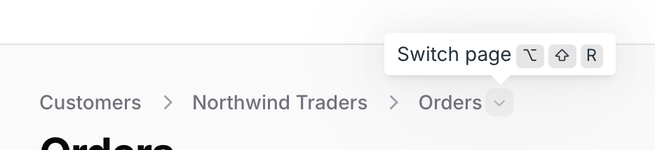

# Relation Navigator pour Filament

<p class="filament-hidden">
    <a href="https://packagist.org/packages/wit3/filament-relation-navigator"></a>
    <a href="https://github.com/wit3/filament-relation-navigator/actions/workflows/tests.yml"></a>
    <a href="https://packagist.org/packages/wit3/filament-relation-navigator"></a>
    <a href="LICENSE.md"></a>
</p>

> **Documentation :** guides, référence de la configuration, guide de mise à jour et recherche sur
> **[wit3.github.io/filament-relation-navigator/fr](https://wit3.github.io/filament-relation-navigator/fr/)**.
>
> **Dernière version :** [Nouveautés](https://wit3.github.io/filament-relation-navigator/fr/reference/changelog) [](https://github.com/wit3/filament-relation-navigator/releases/latest)
>
> **Dans d'autres langues :** la documentation en
> [English](https://wit3.github.io/filament-relation-navigator/) (l'original) · [Italiano](https://wit3.github.io/filament-relation-navigator/it/) · [Español](https://wit3.github.io/filament-relation-navigator/es/) · [Português](https://wit3.github.io/filament-relation-navigator/pt/) · [Deutsch](https://wit3.github.io/filament-relation-navigator/de/) · [中文](https://wit3.github.io/filament-relation-navigator/zh/) · [日本語](https://wit3.github.io/filament-relation-navigator/ja/) · [Русский](https://wit3.github.io/filament-relation-navigator/ru/) · [العربية](https://wit3.github.io/filament-relation-navigator/ar/).
> Chaque langue a aussi son README dans ce dépôt (`README.md`, `README.it.md`...).

<!-- #region intro -->
Donnez à chaque relation manager d'une ressource Filament **sa propre page**,
et passez de l'une à l'autre depuis un **menu dans le fil d'Ariane**.

- `/customers/1?relation=orders` devient **`/customers/1/orders`** : une vraie
  route, que vous pouvez partager, ajouter aux favoris et ouvrir dans un nouvel
  onglet.
- La page affiche **le relation manager que vous avez déjà** : même table,
  mêmes filtres, actions, badges et autorisations. Rien n'est dupliqué.
- Ajoutez un **en-tête** au-dessus de la relation (la fiche de
  l'enregistrement, des widgets, des actions), repris de la ressource.
- Le dernier élément du fil d'Ariane ouvre un **menu** avec les pages de
  l'enregistrement et toutes les relations que l'utilisateur peut voir, avec
  icônes et badges. Deux apparences, une recherche et une navigation au
  clavier en option, une vue à vous et une version pour petits écrans.
- **Enregistrement précédent et suivant** sur la même page, une action
  **« Ouvrir comme page »** sur chaque table de relation manager, et des liens
  vers les anciens onglets qui arrivent sur les nouvelles pages : chacun
  s'active ou se désactive globalement, par ressource ou par page.
- **Un trait, aucune classe de page** : aucun fichier à générer, rien à
  ajouter à `getPages()` ni au panel provider.
- **32 langues**, y compris celles écrites de droite à gauche, avec les codes
  de Filament. La documentation existe en 10 langues.


<!-- #endregion intro -->

## Prérequis

<!-- #region requirements -->
| Paquet   | Version              |
| -------- | -------------------- |
| PHP      | 8.2+                 |
| Laravel  | 12, 13               |
| Filament | 4.13+, 5.x           |
<!-- #endregion requirements -->

## Installation

<!-- #region installation -->
```bash
composer require wit3/filament-relation-navigator
php artisan filament:assets
```

Relancez `filament:assets` après chaque mise à jour : Filament copie la
feuille de style du plugin dans `public/`.
<!-- #endregion installation -->

## Démarrage rapide

<!-- #region quick-start -->
**1. Donnez une page aux relations.** Ajoutez le trait à la ressource :

```php
use Wit3\FilamentRelationNavigator\Concerns\HasRelationPages;

class CustomerResource extends Resource
{
    use HasRelationPages;

    public static function getRelations(): array
    {
        return [
            'orders' => OrdersRelationManager::class,
            'invoices' => InvoicesRelationManager::class,
            NotesRelationManager::class,
        ];
    }
}
```

Chaque relation a maintenant sa page : `/customers/1/orders`,
`/customers/1/invoices`, `/customers/1/notes`.

**2. Ajoutez le menu à la page d'affichage :**

```php
use Wit3\FilamentRelationNavigator\Concerns\HasRelationNavigator;

class ViewCustomer extends ViewRecord
{
    use HasRelationNavigator;
}
```

C'est tout. Les pages de relation ont déjà le menu, et les onglets de la page
d'affichage fonctionnent comme avant.

<picture>
    <source media="(prefers-color-scheme: dark)" srcset="https://raw.githubusercontent.com/wit3/filament-relation-navigator/main/art/relation-page-dark.png">
    
</picture>
<!-- #endregion quick-start -->

## Pages de relation

<!-- #region relation-pages -->
### Les activer

Activez-les sur la ressource, pour tous les relation managers, ou seulement
sur les relation managers de votre choix :

```php
use Wit3\FilamentRelationNavigator\Concerns\InteractsWithRelationPage;

class OrdersRelationManager extends RelationManager
{
    use InteractsWithRelationPage;
}
```

| Configuration                               | Relations avec une page             |
| ------------------------------------------- | ----------------------------------- |
| `HasRelationPages` sur la ressource         | toutes, sauf celles exclues         |
| `InteractsWithRelationPage` sur un manager  | seulement les managers qui l'utilisent |
| Une classe de page écrite par vous (plus bas) | toutes, sauf celles exclues       |

Pour exclure certaines relations :

```php
// Sur la ressource
public static function hasRelationPage(string $slug): bool
{
    return $slug !== 'notes';
}

// Sur un relation manager, avec InteractsWithRelationPage
protected static bool $hasRelationPage = false;
```

Un relation manager partagé par deux ressources s'active pour les deux :
utilisez `hasRelationPage()` de la ressource pour exclure l'une d'elles.

### URL et slugs

| Entrée de `getRelations()`                      | URL                         |
| ----------------------------------------------- | --------------------------- |
| `'orders' => OrdersRelationManager::class`      | `/customers/1/orders`       |
| `SupportTicketsRelationManager::class` (sans clé) | `/customers/1/support-tickets` |
| `RelationGroup::make('Activity', [...])`        | `/customers/1/activity`     |

Le slug propre au relation manager passe en premier
(`protected static ?string $relationPageSlug = 'tickets';`), puis la clé dans
`getRelations()`, puis le nom de la relation en kebab-case (ou le libellé du
groupe : donnez une clé aux groupes, car un libellé traduit change avec la
langue). Les slugs égaux à l'une des clés de page de la ressource (`edit`,
`view`...) sont ignorés, tout comme une seconde relation dont le slug est déjà
pris.

Chaque page est une route nommée, `relations.{slug}` :

```php
CustomerResource::getUrl('relations.orders', ['record' => $customer]);
```

### Autorisations et comportement

Le relation manager reçoit la page d'**affichage** de la ressource comme
`$pageClass` (la page de modification s'il n'y a pas de page d'affichage),
donc `isReadOnly()`, `canViewForRecord()`, `getBadge()` et tous les autres
contrôles se comportent exactement comme dans l'onglet. La page d'affichage
est trouvée par sa clé (`view`, `edit`, ou `$contextPage` sur une classe de
page écrite par vous) ou par sa classe.

Une page de relation exige ce qu'exige la page d'affichage (son `canAccess()`
et la policy `view` de l'enregistrement ; `update` quand elle tient lieu de
page de modification) ainsi que le `canViewForRecord()` du manager. Sans page
d'affichage ni de modification, c'est la policy `view` qui s'applique. Une
policy qui refuse « comme introuvable » donne une 404, tout comme un slug
inconnu. Le menu, la recherche globale et « Ouvrir comme page » ne lient que
les pages que l'utilisateur peut ouvrir.

Les pages de relation n'exécutent pas le code propre à la page d'affichage :
les contrôles de son `authorizeAccess()` ou un `getRelationManagers()` filtré
par utilisateur ne s'y appliquent pas. Placez-les dans les policies, dans
`canViewForRecord()`, ou interdisez une page de relation par enregistrement
sur la ressource :

```php
public static function canAccessRelationPage(Model $record, string $slug): bool
{
    return $slug !== 'audit-logs' || auth()->user()->isAdmin();
}
```
<!-- #endregion relation-pages -->

## En-tête, actions et widgets

<!-- #region header-actions-and-widgets -->
Au-dessus de la relation, une page de relation peut afficher une partie de la
vue de l'enregistrement, des actions d'en-tête et des widgets. Définissez-les
sur la ressource pour toutes les pages de relation, ou sur un relation manager
pour sa propre page :

<picture>
    <source media="(prefers-color-scheme: dark)" srcset="https://raw.githubusercontent.com/wit3/filament-relation-navigator/main/art/relation-page-dark.png">
    
</picture>

```php
public static function relationPageHeader(Schema $schema): Schema
{
    // Toute l'infolist (static::infolist($schema)) ou une partie.
    return $schema->components([
        CustomerCard::make(),
    ]);
}

public static function getRelationPageHeaderActions(): array
{
    return [
        Action::make('email')
            ->url(fn (Customer $record): string => "mailto:{$record->email}"),
    ];
}

public static function getRelationPageHeaderWidgets(): array
{
    return [CustomerStats::class]; // reçoit l'enregistrement dans $record
}

public static function getRelationPageFooterWidgets(): array
{
    return [];
}
```

- L'en-tête d'un relation manager remplace celui de la ressource ; les
  actions et les widgets des deux s'affichent, ceux de la ressource d'abord.
- Les actions d'en-tête agissent sur l'enregistrement auquel appartient la
  relation.
- Avec un en-tête, le nom de l'enregistrement n'est pas répété sous le titre.
- Ce qui n'existe que dans la classe de la page d'affichage (ses propres
  méthodes et modales) n'est pas accessible d'ici : déplacez-le dans la
  ressource, dans une classe d'action ou dans un trait.
<!-- #endregion header-actions-and-widgets -->

## Le menu du fil d'Ariane

<!-- #region the-breadcrumb-menu -->
`HasRelationNavigator` a besoin d'une page avec un enregistrement :
`ViewRecord`, `EditRecord` et les pages qui utilisent `InteractsWithRecord`
ont déjà les deux méthodes qu'il déclare, `getRecord()` et `hasRecord()`. Sur
une page sans enregistrement, PHP le signale dès que la classe est chargée.

Une page de l'enregistrement figure dans le menu si, et seulement si, elle
utilise `HasRelationNavigator` : la page d'affichage, la page de modification
ou toute page personnalisée de l'enregistrement. Sur ces pages, le dernier
élément du fil d'Ariane ouvre le menu. Les pages de relation sont toujours
listées, après les pages de l'enregistrement, avec les icônes et les badges
des relation managers, et seulement quand l'utilisateur peut les voir.

Si la page construit déjà son propre fil d'Ariane, passez-le à
`withRelationNavigator()` :

```php
/**
 * @return array<string | int, string | Htmlable>
 */
public function getBreadcrumbs(): array
{
    return $this->withRelationNavigator([
        CustomerResource::getUrl('index') => 'Customers',
        $this->getBreadcrumb(),
    ]);
}
```

Une page personnalisée qui utilise elle-même `InteractsWithRecord`, au lieu
d'étendre `ViewRecord` ou `EditRecord`, a deux méthodes `getBreadcrumbs()`. Si
elle ne définit pas la sienne, indiquez à PHP laquelle l'emporte :

```php
class CustomerActivity extends Page
{
    use HasRelationNavigator, InteractsWithRecord {
        HasRelationNavigator::getBreadcrumbs insteadof InteractsWithRecord;
        InteractsWithRecord::getBreadcrumbs as getRecordBreadcrumbs;
    }
}
```

Le menu utilise le `$navigationLabel` et le `$navigationIcon` de la page, et
ne l'affiche que si `canAccess()` l'autorise pour l'enregistrement.
<!-- #endregion the-breadcrumb-menu -->

## Ouvrir comme page

<!-- #region open-as-page -->
Sur les pages d'affichage et de modification, chaque relation manager qui a
sa propre page reçoit une action **Ouvrir comme page** dans l'en-tête de sa
table, à côté de son titre et avant ses propres actions. Elle ouvre la page
du relation manager, ou celle de son groupe de relations s'il n'a pas de page
à lui. Sur la page d'un groupe, les managers qui ont leur propre page
reçoivent aussi l'action ; sur sa propre page, un manager ne pointe jamais
vers lui-même.

<picture>
    <source media="(prefers-color-scheme: dark)" srcset="https://raw.githubusercontent.com/wit3/filament-relation-navigator/main/art/open-as-page-dark.png">
    
</picture>

Désactivez-la là où il le faut :

```php
// config/filament-relation-navigator.php : partout
'relation_manager_link' => false,
```

```php
// Sur une ressource : tous ses relation managers
public static function hasRelationPageLinks(): bool
{
    return false;
}
```

```php
// Sur un relation manager (avec InteractsWithRelationPage)
protected static bool $hasRelationPageLink = false;

// ou, sans le trait
public static function hasRelationPageLink(): bool
{
    return false;
}
```

### Son apparence

Par défaut, c'est un lien avec une flèche. Changez-la dans la config :

```php
'relation_manager_action' => [
    'style' => 'button',        // link, button ou icon_button (le libellé devient une infobulle)
    'label' => 'Pleine page',   // texte ou clé de traduction ; null : « Ouvrir comme page », traduit
    'icon' => 'heroicon-m-arrow-top-right-on-square', // n'importe quelle icône Filament, ou null
    'icon_position' => 'after', // ou before
    'color' => 'gray',
    'size' => null,             // sm, md, lg...
    'new_tab' => false,
],
```

Ou modifiez directement l'action Filament, pour tout sauf son URL et le
moment où elle s'affiche, que le package détermine. Chaque niveau reçoit
l'action telle que le précédent l'a laissée :

```php
// Un service provider : tous les relation managers
RelationNavigator::configureRelationPageActionUsing(
    fn (Action $action, RelationManager $relationManager) => $action->outlined()->badge('nouveau'),
);
```

```php
// Une ressource, ou un relation manager : seulement là
public static function configureRelationPageAction(Action $action): Action
{
    return $action->iconButton()->tooltip('Ouvrir les commandes sur leur propre page');
}
```

`RelationNavigator::getRelationManagerPageUrl($relationManager)` renvoie la
même URL, pour un bouton à vous.
<!-- #endregion open-as-page -->

## Enregistrement précédent et suivant

<!-- #region previous-and-next-record -->
Deux boutons avant les actions d'en-tête ouvrent l'enregistrement précédent
ou suivant **sur la même page** : des factures d'un client aux factures du
client suivant.


Un enregistrement qui ne peut pas ouvrir cette page s'ouvre sur sa
première page du menu. Ils sont désactivés par défaut, car ils ajoutent
quelques requêtes à chaque rendu :

```php
'record_navigation' => true,
```

Ils suivent **la liste d'où vient l'utilisateur** : son tri, ses filtres, sa
recherche et son onglet, comme à l'écran (jusqu'à 100 enregistrements ; environ 30 avec des clés UUID). Depuis le premier ou le
dernier enregistrement de cette liste, on ne va pas plus loin, plutôt que de
sauter dans un autre ordre. Un enregistrement absent de la liste (ouvert
depuis un lien) suit l'ordre des clés. Pour toujours suivre l'ordre des clés :

```php
'record_navigation_follows_list' => false,
```

La liste ne mémorise ses enregistrements que si la navigation entre
enregistrements est activée dans la config ou sur la ressource
(`hasRelationNavigatorRecordNavigation()`), car la page de liste ne peut pas
interroger une page d'enregistrement.

Ils parcourent la requête propre à la ressource (`getRecordRouteBindingEloquentQuery()`),
donc la tenancy et vos scopes s'appliquent, et sautent les enregistrements que
l'utilisateur ne peut pas voir. Par page :

```php
public function hasRelationNavigatorRecordNavigation(): bool
{
    return true;
}

public function getRelationNavigatorRecordNavigationQuery(): ?Builder
{
    return Customer::query()->where('active', true);
}
```

Sur une **ressource imbriquée**, ils restent dans le parent : d'une commande
d'un client à la commande suivante du même client. La liste y est le relation
manager du parent : ils suivent son ordre quand la ressource imbriquée est sa
related resource (`protected static ?string $relatedResource`), sauf avec le
driver de session `cookie`, qui ne garde que la liste du parent.
<!-- #endregion previous-and-next-record -->

## Liens vers les onglets des relation managers

<!-- #region links-to-relation-manager-tabs -->
Une fois que les pages de relation remplacent les onglets, les anciens liens
comme `/customers/1?relation=orders` peuvent ouvrir `/customers/1/orders` à la
place :

```php
'redirect_relation_tabs' => true,
```

Les onglets sans page de relation, ou que l'enregistrement ne peut pas voir,
restent où ils sont.
<!-- #endregion links-to-relation-manager-tabs -->

## Recherche globale

<!-- #region global-search -->
Les résultats de la recherche globale peuvent mener directement aux pages de
relation de l'enregistrement : cherchez un client, passez à ses commandes.
Désactivé par défaut, car cela exécute le `canViewForRecord()` des relation
managers pour chaque résultat :

<picture>
    <source media="(prefers-color-scheme: dark)" srcset="https://raw.githubusercontent.com/wit3/filament-relation-navigator/main/art/global-search-dark.png">
    
</picture>

```php
// config/filament-relation-navigator.php
'global_search_actions' => 3, // true pour tous, ou le nombre maximum de liens par résultat
```

```php
// Sur une ressource : activé ou désactivé pour cette ressource seulement
public static function hasRelationPageGlobalSearchActions(): bool
{
    return true;
}
```

```php
// Sur un relation manager (avec InteractsWithRelationPage) : jamais lié
protected static bool $hasRelationPageGlobalSearchAction = false;
```

Les ressources avec `HasRelationPages` reçoivent les liens d'elles-mêmes. Une
ressource qui définit elle-même `getGlobalSearchResultActions()`, ou qui ne
s'active que depuis ses relation managers, les ajoute ainsi :

```php
public static function getGlobalSearchResultActions(Model $record): array
{
    return [
        // ...vos actions
        ...RelationNavigator::getGlobalSearchResultActions(static::class, $record),
    ];
}
```

Les liens suivent les mêmes règles que le menu : seulement les pages de
relation que l'utilisateur peut ouvrir.
<!-- #endregion global-search -->

## Presets du menu

<!-- #region menu-presets -->
Publiez la config :

```bash
php artisan vendor:publish --tag=filament-relation-navigator-config
```

```php
'menu' => [
    'preset' => 'github',   // 'simple', un preset à vous ou un nom de vue
    'presets' => [
        'simple' => 'filament-relation-navigator::menu.simple',
        'github' => 'filament-relation-navigator::menu.github',
    ],
    'searchable' => true,   // un champ de recherche au-dessus de la liste, quel que soit le preset
    'search_from' => 0,     // ...à partir de ce nombre d'éléments
    'badges' => 'lazy',     // les badges des relation managers : 'lazy' à l'ouverture du menu, true avec la page, false désactivés
    'max_height' => '24rem',
    'separator' => true,    // pages de l'enregistrement et pages de relation en deux blocs
    'mobile' => true,       // le menu au-dessus du titre sur les petits écrans
    'shortcut' => 'alt+shift+r', // ouvre le menu ; null le désactive
],
```

**github** (par défaut) : le dernier élément du fil d'Ariane reste du texte et
une petite flèche à côté ouvre un panneau avec un titre, un champ de recherche
et une coche sur la page courante, comme le sélecteur de dépôts de GitHub. Le
champ prend le focus à l'ouverture du menu et Entrée ouvre le premier
résultat.

**simple** : c'est le dernier élément du fil d'Ariane lui-même qui ouvre la
liste. Pour le menu de la 1.2 et des versions précédentes, réglez
`'preset' => 'simple'` et `'searchable' => false`.

<picture>
    <source media="(prefers-color-scheme: dark)" srcset="https://raw.githubusercontent.com/wit3/filament-relation-navigator/main/art/menu-simple-dark.png">
    
</picture>

### Badges

Le menu affiche les badges des relation managers, comme dans leurs onglets.
Par défaut, ils sont **chargés à l'ouverture du menu** : jusque-là le menu est
fermé, donc la page s'affiche sans leurs requêtes, y compris à chaque requête
Livewire qui redessine le fil d'Ariane. Un indicateur de chargement s'affiche
le temps qu'ils arrivent.

```php
'badges' => 'lazy', // par défaut ; true : avec la page ; false : aucun badge
```

Désactivez-les là où il le faut :

```php
// Une page, ou une ressource (statique) : aucun badge dans ce menu
public function hasRelationNavigatorBadges(): bool
{
    return false;
}

// Un relation manager (avec InteractsWithRelationPage) : son badge reste
// dans l'onglet, pas dans le menu
protected static bool $hasRelationNavigatorBadge = false;
```

Un relation manager dont le badge d'onglet est lazy dans Filament
(`protected static ?bool $isBadgeLazyLoaded = true;`, ou `$isBadgeDeferred` sur
Filament 4.13) est lazy aussi dans le menu, même avec `'badges' => true`.

Les vues du menu qui ne savent pas charger les badges plus tard (vues du
package publiées avant la 1.3, ou presets à vous qui affichent `$item->badge`
eux-mêmes) les reçoivent avec la page, comme avant : rien ne disparaît.

**Clavier** : depuis le champ de recherche, Bas entre dans la liste ; Haut et
Bas passent d'une page à l'autre, Entrée en ouvre une, Échap ferme le menu.

### Raccourci et infobulle

<picture>
    <source media="(prefers-color-scheme: dark)" srcset="https://raw.githubusercontent.com/wit3/filament-relation-navigator/main/art/tooltip-dark.png">
    
</picture>

Le bouton qui ouvre le menu a une infobulle avec le raccourci, affiché avec
les touches du Mac ou de Windows/Linux. Le raccourci ouvre le menu depuis
n'importe où sur la page, avec le champ de recherche prêt, comme le sélecteur
de dépôts de GitHub : <kbd>⌥</kbd> <kbd>⇧</kbd> <kbd>R</kbd> sur Mac,
<kbd>Alt</kbd> <kbd>Shift</kbd> <kbd>R</kbd> ailleurs. Changez-le dans la
config ou par page :

```php
'shortcut' => 'mod+shift+p', // mod vaut ⌘ sur Mac et Ctrl ailleurs
```

```php
public function getRelationNavigatorShortcut(): ?string
{
    return null; // aucun raccourci sur cette page
}
```

Il est conçu pour ne pas gêner :

- il reconnaît la touche physique, donc il fonctionne avec n'importe quelle
  disposition de clavier et avec Option sur Mac (où
  <kbd>⌥</kbd><kbd>⇧</kbd><kbd>R</kbd> tape ‰) ;
- il ne fait rien pendant que vous tapez dans un champ ;
- un raccourci de la recherche globale du panel (`globalSearchKeyBindings()`)
  n'est jamais pris : le menu n'a alors pas de raccourci ;
- seul le menu visible s'ouvre (fil d'Ariane ou petits écrans).

Touches prises en charge : `alt`, `shift`, `ctrl`, `meta`, `mod` plus une
lettre, un chiffre ou `/ . , ;`.

<picture>
    <source media="(prefers-color-scheme: dark)" srcset="https://raw.githubusercontent.com/wit3/filament-relation-navigator/main/art/menu-github-search-dark.png">
    
</picture>

### Page, ressource ou config

Chaque option a trois niveaux. La page l'emporte, puis la ressource, puis la
config :

| Méthode de la page (statique sur la ressource) | Clé de config |
|---|---|
| `getRelationNavigatorPreset(): string` | `menu.preset` |
| `isRelationNavigatorSearchable(): bool` | `menu.searchable` |
| `hasRelationNavigatorBadges(): bool` | `menu.badges` |
| `hasDeferredRelationNavigatorBadges(): bool` | `menu.badges` = `'lazy'` |
| `getRelationNavigatorShortcut(): ?string` | `menu.shortcut` |
| `hasRelationNavigatorMobileMenu(): bool` | `menu.mobile` |
| `hasRelationNavigatorRecordNavigation(): bool` | `record_navigation` |
| `shouldRelationNavigatorRecordNavigationFollowList(): bool` | `record_navigation_follows_list` |
| `shouldRedirectRelationNavigatorTabs(): bool` | `redirect_relation_tabs` |

```php
// Sur une page
public function isRelationNavigatorSearchable(): bool
{
    return false;
}
```

```php
// Sur une ressource : la même méthode, statique, pour toutes ses pages
public static function hasRelationNavigatorRecordNavigation(): bool
{
    return true;
}
```

### Petits écrans

Filament masque le fil d'Ariane en dessous de 40rem. Le menu s'affiche alors
au-dessus du titre de la page, sur chaque page qui utilise
`HasRelationNavigator`, avec les mêmes options de preset. Désactivez-le avec
`'mobile' => false`, ou par page :

```php
public function hasRelationNavigatorMobileMenu(): bool
{
    return false;
}
```

<picture>
    <source media="(prefers-color-scheme: dark)" srcset="https://raw.githubusercontent.com/wit3/filament-relation-navigator/main/art/mobile-dark.png">
    
</picture>

### Traductions

32 langues, avec les mêmes codes que Filament : allemand, anglais, arabe,
bulgare, catalan, chinois (simplifié et traditionnel), coréen, danois,
espagnol, finnois, français, grec, hébreu, hongrois, indonésien, italien,
japonais, néerlandais, norvégien, persan, polonais, portugais (Portugal et
Brésil), roumain, russe, slovaque, suédois, tchèque, turc, ukrainien et
vietnamien. Dans les langues de droite à gauche, les flèches précédent et
suivant s'inversent. Publiez les traductions pour les modifier ou ajouter une
langue :

```bash
php artisan vendor:publish --tag=filament-relation-navigator-translations
```

### Votre propre preset

Partez de l'un des presets du package :

```bash
php artisan make:filament-relation-navigator-preset compact --from=github
```

La commande copie le preset dans
`resources/views/filament/relation-navigator/compact.blade.php`. Enregistrez-le
et modifiez-le à votre guise :

```php
'preset' => 'compact',
'presets' => [
    // ...
    'compact' => 'filament.relation-navigator.compact',
],
```

N'importe quel nom de vue fonctionne aussi comme `preset`. Pour modifier les
presets du package eux-mêmes, publiez leurs vues :

```bash
php artisan vendor:publish --tag=filament-relation-navigator-views
```

Une vue de preset reçoit :

| Variable             | Contenu                                                                 |
| -------------------- | ----------------------------------------------------------------------- |
| `$label`             | Le dernier élément du fil d'Ariane                                      |
| `$items`             | Les éléments du menu : `key`, `label`, `url`, `icon`, `badge`, `badgeColor`, `isActive` |
| `$heading`           | "Switch page", traduit                                                  |
| `$isSearchable`      | S'il faut afficher le champ de recherche                                |
| `$hasSeparator`      | S'il faut séparer pages de l'enregistrement et pages de relation en deux blocs |
| `$shortcut`          | Le raccourci, ou null                                                   |
| `$shortcutKeys`      | Les touches à afficher : `['mac' => [...], 'other' => [...]]`           |
| `$searchPlaceholder` | "Find a page…", traduit                                                 |
| `$emptyLabel`        | "No pages found.", traduit                                              |
| `$maxHeight`         | `menu.max_height`                                                       |

Pour donner à votre bouton l'infobulle et le raccourci, incluez
`filament-relation-navigator::menu.partials.trigger-attributes` dans sa
balise. Chaque élément a aussi `isRelationPage()`. Pour réutiliser le champ de
recherche, la liste (avec le séparateur et la navigation au clavier) et la
ligne « aucun résultat », incluez
`filament-relation-navigator::menu.partials.list` avec `showCheck`.
<!-- #endregion menu-presets -->

## Personnaliser les pages de relation

<!-- #region customising-the-relation-pages -->
### Titre, sous-titre et fil d'Ariane d'une relation

Un relation manager peut les définir pour sa propre page, à partir de
l'enregistrement, sans classe de page :

```php
class OrdersRelationManager extends RelationManager
{
    public static function getRelationPageTitle(Model $ownerRecord): string|Htmlable|null
    {
        return "Commandes de {$ownerRecord->name}";
    }

    public static function getRelationPageSubheading(Model $ownerRecord): string|Htmlable|null
    {
        return '12 derniers mois';
    }

    public static function getRelationPageBreadcrumb(Model $ownerRecord): ?string
    {
        return 'Commandes';
    }
}
```

Renvoyez `null` pour garder la valeur par défaut. Une classe de page écrite
par vous (plus bas) l'emporte avec ses propres `$title`, `$subheading` et
`$breadcrumb`. Le menu et les onglets gardent le titre du relation manager.
Les groupes de relations n'ont pas de relation manager, donc leur page
utilise le libellé du groupe.

### Votre propre classe de page

Les pages de relation générées couvrent la plupart des besoins. Pour changer
leur titre, leur fil d'Ariane ou tout ce qu'une page Filament peut faire,
écrivez vous-même la classe de page ; le package utilise alors la vôtre pour
cette ressource :

```bash
php artisan make:filament-relation-navigator CustomerResource
```

```php
class CustomerRelationPage extends RelationPage
{
    protected static string $resource = CustomerResource::class;

    protected static ?array $relations = ['orders', 'invoices'];  // seulement celles-ci
    protected static array $excludedRelations = ['notes'];         // jamais celles-ci
}
```

```php
public static function getPages(): array
{
    return [
        'index' => ListCustomers::route('/'),
        'view' => ViewCustomer::route('/{record}'),
        ...CustomerRelationPage::relationRoutes(),
    ];
}
```

La classe est une page Filament ordinaire : surchargez `getTitle()`,
`getBreadcrumbs()`, `getHeaderActions()`, utilisez vos propres traits, etc.
<!-- #endregion customising-the-relation-pages -->

## Sous-navigation native de l'enregistrement

<!-- #region native-record-sub-navigation -->
Les mêmes éléments peuvent alimenter la sous-navigation d'enregistrement de
Filament :

```php
public static function getRecordSubNavigation(Page $page): array
{
    return RelationNavigator::getRecordSubNavigation($page);
}
```
<!-- #endregion native-record-sub-navigation -->

## Fonctionnement

<!-- #region how-it-works -->
- Les routes sont enregistrées par le `Resource::registerRoutes()` de
  Filament, dans le groupe de routes de chaque ressource : slug, cluster,
  ressource parente et tenant sont gérés par Filament.
- La classe de page d'une ressource est écrite à la demande dans
  `storage/framework/cache`, comme les real-time facades de Laravel, et
  enregistrée auprès de Livewire. Elle fonctionne avec `route:cache`.
- La page de relation intègre le relation manager comme Filament le fait dans
  les onglets, donc son état, ses actions et ses modales restent dans le
  relation manager.
<!-- #endregion how-it-works -->

## Agents IA

<!-- #region ai-agents -->
Le package apprend aux agents de code IA à s'en servir, pour que Claude Code,
Codex, Cursor, Copilot et consorts écrivent correctement les traits et les
options :

- **Laravel Boost** : le package fournit des guidelines et une skill
  (`relation-navigator-development`). Choisissez `wit3/filament-relation-navigator`
  quand vous lancez `php artisan boost:install` (ou `boost:update`).
- **llms.txt** : la documentation est aussi publiée pour les agents, sous
  forme d'index ([llms.txt](https://wit3.github.io/filament-relation-navigator/llms.txt))
  et de fichier unique
  ([llms-full.txt](https://wit3.github.io/filament-relation-navigator/llms-full.txt)),
  en anglais. Chaque page a aussi une version Markdown : ajoutez `.md` à son
  URL.
- **Sans Boost** : indiquez à votre agent
  `vendor/wit3/filament-relation-navigator/resources/boost/skills/relation-navigator-development/SKILL.md`,
  par exemple depuis votre `AGENTS.md` ou `CLAUDE.md`.
<!-- #endregion ai-agents -->

## Tests

<!-- #region testing -->
```bash
composer test        # la suite de tests
composer analyse     # PHPStan, niveau 8
composer format      # Pint
```

La suite tourne sur Filament 4 et 5, Laravel 12 et 13, PHP 8.2 à 8.5, et
couvre les ressources imbriquées, les clusters, la tenancy et le mode SPA.

Les tests navigateur (le menu avec recherche) nécessitent Playwright :

```bash
npm install && npx playwright install chromium
vendor/bin/testbench filament:assets
composer test:browser
```
<!-- #endregion testing -->

## Changelog

<!-- #region changelog -->
Voir le [CHANGELOG](https://github.com/wit3/filament-relation-navigator/blob/main/CHANGELOG.md) (en anglais).
<!-- #endregion changelog -->

## Contribuer

<!-- #region contributing -->
Les issues et les pull requests sont les bienvenues. Lancez `composer test`,
`composer analyse` et `composer format` avant d'ouvrir une pull request.
<!-- #endregion contributing -->

## Sécurité

<!-- #region security -->
Signalez les problèmes de sécurité en privé via les
[GitHub security advisories](https://github.com/wit3/filament-relation-navigator/security/advisories/new),
et non dans les issues publiques.
<!-- #endregion security -->

## Crédits

<!-- #region credits -->
- [Salvatore Scalzi](https://github.com/wit3)
- [Tous les contributeurs](https://github.com/wit3/filament-relation-navigator/contributors)
<!-- #endregion credits -->

## Licence

<!-- #region license -->
Licence MIT. Voir [LICENSE](https://github.com/wit3/filament-relation-navigator/blob/main/LICENSE.md).
<!-- #endregion license -->
