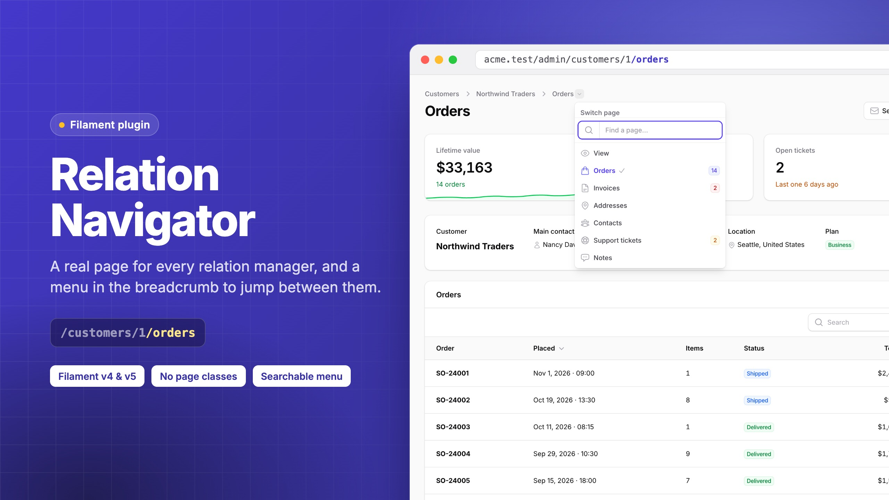
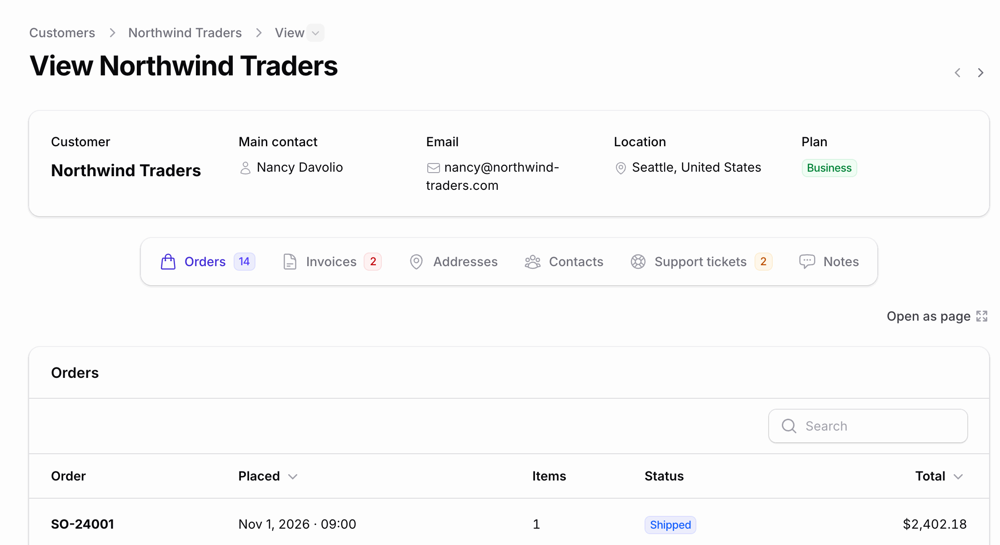
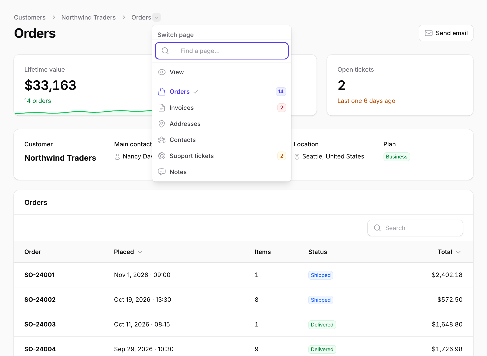
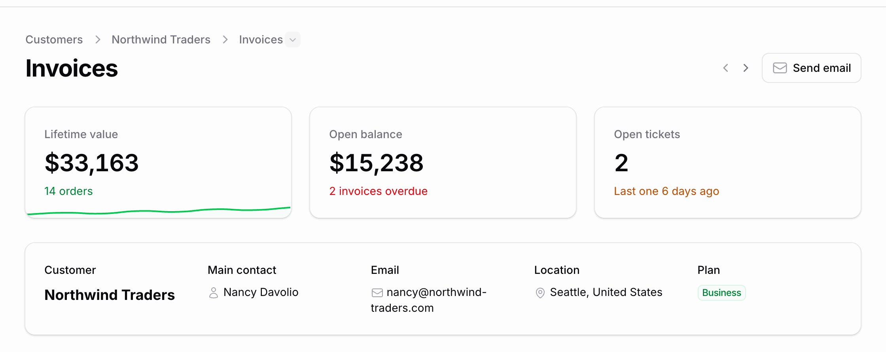

# Filament 用 Relation Navigator

<p class="filament-hidden">
    <a href="https://packagist.org/packages/wit3/filament-relation-navigator"></a>
    <a href="https://github.com/wit3/filament-relation-navigator/actions/workflows/tests.yml"></a>
    <a href="https://packagist.org/packages/wit3/filament-relation-navigator"></a>
    <a href="LICENSE.md"></a>
</p>

> **ドキュメント：** ガイド、設定リファレンス、アップグレードガイド、検索は
> **[wit3.github.io/filament-relation-navigator/ja](https://wit3.github.io/filament-relation-navigator/ja/)** にあります。
>
> **最新バージョン：** [新機能](https://wit3.github.io/filament-relation-navigator/ja/reference/changelog) [](https://github.com/wit3/filament-relation-navigator/releases/latest)
>
> **他の言語：** ドキュメントは
> [English](https://wit3.github.io/filament-relation-navigator/)（原文）· [Italiano](https://wit3.github.io/filament-relation-navigator/it/) · [Español](https://wit3.github.io/filament-relation-navigator/es/) · [Português](https://wit3.github.io/filament-relation-navigator/pt/) · [Français](https://wit3.github.io/filament-relation-navigator/fr/) · [Deutsch](https://wit3.github.io/filament-relation-navigator/de/) · [中文](https://wit3.github.io/filament-relation-navigator/zh/) · [Русский](https://wit3.github.io/filament-relation-navigator/ru/) · [العربية](https://wit3.github.io/filament-relation-navigator/ar/) でも読めます。
> 各言語の README もこのリポジトリにあります（`README.md`、`README.it.md`...）。

<!-- #region intro -->
Filament のリソースにあるリレーションマネージャーそれぞれに**専用のページ**を用意し、**パンくずリストのメニュー**からページを行き来できるようにします。

- `/customers/1?relation=orders` が **`/customers/1/orders`** になります。リンクやブックマークができ、新しいタブでも開ける本物のルートです。
- ページには**すでにあるリレーションマネージャー**がそのまま表示されます。テーブル、フィルター、アクション、バッジ、認可も同じです。重複するものは何もありません。
- リレーションの上に、リソースから取得した**ヘッダー**（レコードのカード、ウィジェット、アクション）を追加できます。
- パンくずリストの最後の項目から**メニュー**が開き、レコードのページと、ユーザーが閲覧できるすべてのリレーションがアイコンとバッジ付きで並びます。2 種類の見た目、任意の検索とキーボード操作、独自のビュー、小さな画面向けの表示があります。
- 同じページのまま移動できる**前後のレコード**、すべてのリレーションマネージャーのテーブルにある「**ページとして開く**」アクション、古いタブへのリンクを新しいページへ転送する機能があります。どれもグローバル、リソース単位、ページ単位で切り替えられます。
- **トレイト 1 つだけで、ページクラスは不要**です。生成するファイルも、`getPages()` やパネルプロバイダーへの追記もありません。
- **32 言語**に対応（右から左に書く言語を含む）。言語コードは Filament と同じです。ドキュメントは 10 言語で提供しています。


<!-- #endregion intro -->

## 要件

<!-- #region requirements -->
| パッケージ | バージョン           |
| ---------- | -------------------- |
| PHP        | 8.2+                 |
| Laravel    | 12, 13               |
| Filament   | 4.13+, 5.x           |
<!-- #endregion requirements -->

## インストール

<!-- #region installation -->
```bash
composer require wit3/filament-relation-navigator
php artisan filament:assets
```

更新のたびに `filament:assets` を再実行してください。Filament がプラグインのスタイルシートを `public/` にコピーします。
<!-- #endregion installation -->

## クイックスタート

<!-- #region quick-start -->
**1. リレーションにページを与えます。** リソースにトレイトを追加します。

```php
use Wit3\FilamentRelationNavigator\Concerns\HasRelationPages;

class CustomerResource extends Resource
{
    use HasRelationPages;

    public static function getRelations(): array
    {
        return [
            'orders' => OrdersRelationManager::class,
            'invoices' => InvoicesRelationManager::class,
            NotesRelationManager::class,
        ];
    }
}
```

これで各リレーションにページができます：`/customers/1/orders`、`/customers/1/invoices`、`/customers/1/notes`。

**2. 詳細ページにメニューを追加します。**

```php
use Wit3\FilamentRelationNavigator\Concerns\HasRelationNavigator;

class ViewCustomer extends ViewRecord
{
    use HasRelationNavigator;
}
```

これだけです。リレーションページにはすでにメニューがあり、詳細ページのタブもこれまでどおり動作します。

<picture>
    <source media="(prefers-color-scheme: dark)" srcset="https://raw.githubusercontent.com/wit3/filament-relation-navigator/main/art/relation-page-dark.png">
    
</picture>
<!-- #endregion quick-start -->

## リレーションページ

<!-- #region relation-pages -->
### 有効にする

リソースで有効にしてすべてのリレーションマネージャーに適用するか、必要なリレーションマネージャーだけで有効にします。

```php
use Wit3\FilamentRelationNavigator\Concerns\InteractsWithRelationPage;

class OrdersRelationManager extends RelationManager
{
    use InteractsWithRelationPage;
}
```

| 設定方法                                    | ページを持つリレーション            |
| ------------------------------------------- | ----------------------------------- |
| リソースに `HasRelationPages`               | すべて（除外したものを除く）        |
| マネージャーに `InteractsWithRelationPage`  | 有効にしたマネージャーのみ          |
| 自分で書いたページクラス（後述）            | すべて（除外したものを除く）        |

一部のリレーションを除外するには：

```php
// リソース側
public static function hasRelationPage(string $slug): bool
{
    return $slug !== 'notes';
}

// リレーションマネージャー側（InteractsWithRelationPage を使用）
protected static bool $hasRelationPage = false;
```

2 つのリソースで共有しているリレーションマネージャーは、両方で有効になります。片方だけ除外するには、リソースの `hasRelationPage()` を使ってください。

### URL とスラッグ

| `getRelations()` のエントリ                     | URL                         |
| ----------------------------------------------- | --------------------------- |
| `'orders' => OrdersRelationManager::class`      | `/customers/1/orders`       |
| `SupportTicketsRelationManager::class`（キーなし） | `/customers/1/support-tickets` |
| `RelationGroup::make('Activity', [...])`        | `/customers/1/activity`     |

リレーションマネージャー自身のスラッグ（`protected static ?string $relationPageSlug = 'tickets';`）が最優先で、次に `getRelations()` のキー、その次にリレーション名をケバブケースにしたもの（グループの場合はラベル。翻訳されたラベルは言語によって変わるので、グループにはキーを付けてください）が使われます。リソースのページキー（`edit`、`view`...）と同じスラッグはスキップされ、すでに使われているスラッグを持つ 2 つ目のリレーションもスキップされます。

各ページは名前付きルート `relations.{slug}` です。

```php
CustomerResource::getUrl('relations.orders', ['record' => $customer]);
```

### 認可と動作

リレーションマネージャーは `$pageClass` としてリソースの**詳細**ページ（詳細ページがない場合は編集ページ）を受け取ります。そのため `isReadOnly()`、`canViewForRecord()`、`getBadge()` などのチェックは、タブの場合とまったく同じように動作します。詳細ページはキー（`view`、`edit`、または自分で書いたページクラスの `$contextPage`）か、クラスで見つけます。

リレーションページを開くには、詳細ページと同じ条件（その `canAccess()` とレコードの `view` ポリシー。編集ページの代わりになる場合は `update`）と、マネージャーの `canViewForRecord()` が必要です。詳細ページも編集ページもない場合は `view` ポリシーが適用されます。「見つからない」として拒否するポリシーは 404 になり、不明なスラッグも同様です。メニュー、グローバル検索、「ページとして開く」は、ユーザーが開けるページだけにリンクします。

リレーションページでは、詳細ページ自身のコードは実行されません。その `authorizeAccess()` 内のチェックや、ユーザーごとに絞り込んだ `getRelationManagers()` は適用されません。ポリシーや `canViewForRecord()` に書くか、リソースでレコードごとにリレーションページを拒否してください。

```php
public static function canAccessRelationPage(Model $record, string $slug): bool
{
    return $slug !== 'audit-logs' || auth()->user()->isAdmin();
}
```
<!-- #endregion relation-pages -->

## ヘッダー、アクション、ウィジェット

<!-- #region header-actions-and-widgets -->
リレーションページでは、リレーションの上にレコードの詳細表示の一部、ヘッダーアクション、ウィジェットを表示できます。すべてのリレーションページ向けにはリソースで、そのページだけ向けにはリレーションマネージャーで定義します。

<picture>
    <source media="(prefers-color-scheme: dark)" srcset="https://raw.githubusercontent.com/wit3/filament-relation-navigator/main/art/relation-page-dark.png">
    
</picture>

```php
public static function relationPageHeader(Schema $schema): Schema
{
    // infolist 全体（static::infolist($schema)）またはその一部。
    return $schema->components([
        CustomerCard::make(),
    ]);
}

public static function getRelationPageHeaderActions(): array
{
    return [
        Action::make('email')
            ->url(fn (Customer $record): string => "mailto:{$record->email}"),
    ];
}

public static function getRelationPageHeaderWidgets(): array
{
    return [CustomerStats::class]; // レコードを $record として受け取ります
}

public static function getRelationPageFooterWidgets(): array
{
    return [];
}
```

- リレーションマネージャーのヘッダーは、リソースのヘッダーを置き換えます。アクションとウィジェットは両方が表示され、リソースのものが先に並びます。
- ヘッダーアクションは、リレーションの所有元のレコードに対して実行されます。
- ヘッダーがある場合、レコード名はタイトルの下に繰り返し表示されません。
- 詳細ページのクラスの中にしか存在しないもの（そのクラス独自のメソッドやモーダル）は、ここからは使えません。リソース、アクションクラス、またはトレイトに移してください。
<!-- #endregion header-actions-and-widgets -->

## パンくずリストのメニュー

<!-- #region the-breadcrumb-menu -->
`HasRelationNavigator` にはレコードを持つページが必要です。`ViewRecord`、`EditRecord`、`InteractsWithRecord` を使うページは、このトレイトが宣言する 2 つのメソッド `getRecord()` と `hasRecord()` をすでに持っています。レコードのないページでは、クラスが読み込まれた時点で PHP がエラーを出します。

レコードのページがメニューに載るのは、そのページが `HasRelationNavigator` を使っている場合だけです。対象は詳細ページ、編集ページ、またはレコードの任意のカスタムページです。それらのページでは、パンくずリストの最後の項目からメニューが開きます。リレーションページは常に、レコードのページの後に、リレーションマネージャーのアイコンとバッジ付きで並びます。ただし、ユーザーが閲覧できる場合に限ります。

ページがすでに独自のパンくずリストを組み立てている場合は、`withRelationNavigator()` に渡してください。

```php
public function getBreadcrumbs(): array
{
    return $this->withRelationNavigator([
        CustomerResource::getUrl('index') => 'Customers',
        $this->getBreadcrumb(),
    ]);
}
```

`ViewRecord` や `EditRecord` を継承せずに自分で `InteractsWithRecord` を使うカスタムページには、`getBreadcrumbs()` メソッドが 2 つあります。独自に定義しない場合は、どちらを優先するかを PHP に指定してください。

```php
class CustomerActivity extends Page
{
    use HasRelationNavigator, InteractsWithRecord {
        HasRelationNavigator::getBreadcrumbs insteadof InteractsWithRecord;
        InteractsWithRecord::getBreadcrumbs as getRecordBreadcrumbs;
    }
}
```

メニューはページの `$navigationLabel` と `$navigationIcon` を使い、`canAccess()` がそのレコードに対して許可する場合にだけページを表示します。
<!-- #endregion the-breadcrumb-menu -->

## ページとして開く

<!-- #region open-as-page -->
詳細ページと編集ページでは、専用ページを持つすべてのリレーションマネージャーのテーブルヘッダーに、タイトルの隣、独自のアクションの前に「**ページとして開く**」アクションが追加されます。このアクションはリレーションマネージャー自身のページを開き、専用ページがない場合は所属するリレーショングループのページを開きます。グループのページでは、専用ページを持つマネージャーにもこのアクションが付きます。マネージャー自身のページでは、自分自身へのリンクは表示されません。

<picture>
    <source media="(prefers-color-scheme: dark)" srcset="https://raw.githubusercontent.com/wit3/filament-relation-navigator/main/art/open-as-page-dark.png">
    
</picture>

必要な場所で無効にできます。

```php
// config/filament-relation-navigator.php: すべての場所で
'relation_manager_link' => false,
```

```php
// リソース側: そのすべてのリレーションマネージャー
public static function hasRelationPageLinks(): bool
{
    return false;
}
```

```php
// リレーションマネージャー側（InteractsWithRelationPage を使用）
protected static bool $hasRelationPageLink = false;

// またはトレイトなしで
public static function hasRelationPageLink(): bool
{
    return false;
}
```

### 見た目

デフォルトは矢印付きのリンクです。設定で変更できます。

```php
'relation_manager_action' => [
    'style' => 'button',        // link、button、icon_button（ラベルはツールチップになります）
    'label' => 'ページ全体',    // テキストまたは翻訳キー。null:「ページとして開く」（翻訳済み）
    'icon' => 'heroicon-m-arrow-top-right-on-square', // Filament の任意のアイコン、または null
    'icon_position' => 'after', // または before
    'color' => 'gray',
    'size' => null,             // sm、md、lg...
    'new_tab' => false,
],
```

または、Filament のアクションそのものを変更することもできます。URL と表示する条件はパッケージが決めますが、それ以外は自由に変更できます。各レベルは、前のレベルが変更した状態のアクションを受け取ります。

```php
// サービスプロバイダー: すべてのリレーションマネージャー
RelationNavigator::configureRelationPageActionUsing(
    fn (Action $action, RelationManager $relationManager) => $action->outlined()->badge('新規'),
);
```

```php
// リソースまたはリレーションマネージャー: そこだけ
public static function configureRelationPageAction(Action $action): Action
{
    return $action->iconButton()->tooltip('注文を専用ページで開く');
}
```

`RelationNavigator::getRelationManagerPageUrl($relationManager)` は同じ URL を返します。独自のボタンに使えます。
<!-- #endregion open-as-page -->

## 前後のレコード

<!-- #region previous-and-next-record -->
ヘッダーアクションの前にある 2 つのボタンで、前または次のレコードを**同じページのまま**開けます。ある顧客の請求書から、次の顧客の請求書へ移動できます。



そのページを開けないレコードは、メニューの最初のページで開きます。レンダリングのたびにいくつかクエリが増えるため、デフォルトでは無効です。

```php
'record_navigation' => true,
```

ボタンは**ユーザーが来た一覧**に従います。画面に表示されているとおりの並び順、フィルター、検索、タブです（最大 100 件。UUID キーの場合は約 30 件）。その一覧の最初または最後のレコードからは、別の並び順に移るのではなく、それ以上は進みません。一覧にないレコード（リンクから開いたもの）はキーの順に移動します。常にキーの順に移動するには：

```php
'record_navigation_follows_list' => false,
```

一覧がレコードを記憶するのは、設定またはリソース（`hasRelationNavigatorRecordNavigation()`）でレコードナビゲーションが有効な場合だけです。一覧ページからはレコードページに問い合わせられないためです。

ボタンはリソース自身のクエリ（`getRecordRouteBindingEloquentQuery()`）で移動するので、テナンシーや独自のスコープが適用され、ユーザーが閲覧できないレコードはスキップされます。ページごとに設定するには：

```php
public function hasRelationNavigatorRecordNavigation(): bool
{
    return true;
}

public function getRelationNavigatorRecordNavigationQuery(): ?Builder
{
    return Customer::query()->where('active', true);
}
```

**ネストされたリソース**では、親の範囲内にとどまります。ある顧客の注文から、同じ顧客の次の注文へ移動します。そこでの一覧は親のリレーションマネージャーです。ネストされたリソースがその関連リソース（`protected static ?string $relatedResource`）である場合は、その並び順に従います。ただし `cookie` セッションドライバーでは、親の一覧しか保持されません。
<!-- #endregion previous-and-next-record -->

## リレーションマネージャーのタブへのリンク

<!-- #region links-to-relation-manager-tabs -->
リレーションページがタブの代わりになったら、`/customers/1?relation=orders` のような古いリンクで `/customers/1/orders` を開くようにできます。

```php
'redirect_relation_tabs' => true,
```

リレーションページのないタブや、そのレコードでは閲覧できないタブは、そのまま残ります。
<!-- #endregion links-to-relation-manager-tabs -->

## グローバル検索

<!-- #region global-search -->
グローバル検索の結果から、レコードのリレーションページへ直接リンクできます。顧客を検索して、その注文へすぐに移動できます。結果ごとにリレーションマネージャーの `canViewForRecord()` を実行するため、デフォルトでは無効です。

<picture>
    <source media="(prefers-color-scheme: dark)" srcset="https://raw.githubusercontent.com/wit3/filament-relation-navigator/main/art/global-search-dark.png">
    
</picture>

```php
// config/filament-relation-navigator.php
'global_search_actions' => 3, // true ですべて、または結果ごとのリンクの最大数
```

```php
// リソース側: このリソースだけで有効または無効にする
public static function hasRelationPageGlobalSearchActions(): bool
{
    return true;
}
```

```php
// リレーションマネージャー側（InteractsWithRelationPage を使用）: リンクしない
protected static bool $hasRelationPageGlobalSearchAction = false;
```

`HasRelationPages` を使うリソースには、自動的にリンクが付きます。`getGlobalSearchResultActions()` を自分で定義しているリソースや、リレーションマネージャー側だけで有効にしているリソースでは、次のようにマージします。

```php
public static function getGlobalSearchResultActions(Model $record): array
{
    return [
        // ...独自のアクション
        ...RelationNavigator::getGlobalSearchResultActions(static::class, $record),
    ];
}
```

リンクはメニューと同じルールに従い、ユーザーが開けるリレーションページだけが表示されます。
<!-- #endregion global-search -->

## メニューのプリセット

<!-- #region menu-presets -->
設定ファイルを公開します。

```bash
php artisan vendor:publish --tag=filament-relation-navigator-config
```

```php
'menu' => [
    'preset' => 'github',   // 'simple'、独自のプリセット、またはビュー名
    'presets' => [
        'simple' => 'filament-relation-navigator::menu.simple',
        'github' => 'filament-relation-navigator::menu.github',
    ],
    'searchable' => true,   // プリセットに関係なく、リストの上に検索フィールドを表示
    'search_from' => 0,     // ...項目がこの数以上のとき
    'badges' => 'lazy',     // リレーションマネージャーのバッジ: 'lazy' はメニューを開いたとき、true はページと一緒、false は無効
    'max_height' => '24rem',
    'separator' => true,    // レコードのページとリレーションページを 2 つのブロックに分ける
    'mobile' => true,       // 小さな画面では見出しの上にメニューを表示
    'shortcut' => 'alt+shift+r', // メニューを開くショートカット。null で無効
],
```

**github**（デフォルト）：パンくずリストの最後の項目はテキストのままで、その横のキャレットからパネルが開きます。パネルには見出し、検索フィールド、現在のページのチェックマークがあり、GitHub のリポジトリ切り替えと同じような形です。メニューを開くと検索フィールドにフォーカスが移り、Enter で最初の一致を開きます。

**simple**：パンくずリストの最後の項目そのものがリストを開きます。1.2 以前のメニューにするには、`'preset' => 'simple'` と `'searchable' => false` を設定します。

<picture>
    <source media="(prefers-color-scheme: dark)" srcset="https://raw.githubusercontent.com/wit3/filament-relation-navigator/main/art/menu-simple-dark.png">
    
</picture>

### バッジ

メニューには、タブと同じようにリレーションマネージャーのバッジが表示されます。デフォルトでは**メニューを開いたときに読み込まれます**。それまでメニューは閉じているので、ページはバッジのクエリなしでレンダリングされます。パンくずリストを再描画するすべての Livewire リクエストでも同様です。読み込みの間はスピナーが表示されます。

```php
'badges' => 'lazy', // デフォルト。true: ページと一緒、false: バッジなし
```

必要な場所で無効にできます。

```php
// ページまたはリソース（static）: このメニューにバッジを表示しない
public function hasRelationNavigatorBadges(): bool
{
    return false;
}

// リレーションマネージャー（InteractsWithRelationPage を使用）: バッジはタブに残り、
// メニューには表示しない
protected static bool $hasRelationNavigatorBadge = false;
```

Filament でタブのバッジを遅延読み込みにしているリレーションマネージャー（`protected static ?bool $isBadgeLazyLoaded = true;`、Filament 4.13 では `$isBadgeDeferred`）は、`'badges' => true` の場合でもメニューで遅延読み込みになります。

後からバッジを読み込めないメニュービュー（1.3 より前に公開したパッケージのビューや、`$item->badge` を自分で描画する独自のプリセット）は、これまでどおりページと一緒にバッジを受け取ります。表示されなくなるものはありません。

**キーボード**：検索フィールドで下キーを押すとリストに移動します。上下キーでページ間を移動し、Enter で開き、Escape でメニューを閉じます。

### ショートカットとツールチップ

<picture>
    <source media="(prefers-color-scheme: dark)" srcset="https://raw.githubusercontent.com/wit3/filament-relation-navigator/main/art/tooltip-dark.png">
    
</picture>

メニューを開くボタンには、ショートカットを Mac または Windows/Linux のキーで示すツールチップがあります。ショートカットを押すと、GitHub のリポジトリ切り替えと同じように、ページのどこからでも検索フィールドがすぐ使える状態でメニューが開きます。Mac では <kbd>⌥</kbd> <kbd>⇧</kbd> <kbd>R</kbd>、それ以外では <kbd>Alt</kbd> <kbd>Shift</kbd> <kbd>R</kbd> です。設定またはページごとに変更できます。

```php
'shortcut' => 'mod+shift+p', // mod は Mac では ⌘、それ以外では Ctrl
```

```php
public function getRelationNavigatorShortcut(): ?string
{
    return null; // このページではショートカットなし
}
```

邪魔にならないように作られています。

- 物理キーで判定するので、どのキーボードレイアウトでも、Mac の Option キー（<kbd>⌥</kbd><kbd>⇧</kbd><kbd>R</kbd> で ‰ が入力される）でも動作します。
- フィールドに入力している間は何もしません。
- パネルのグローバル検索のショートカット（`globalSearchKeyBindings()`）を横取りすることはありません。その場合、メニューにはショートカットが付きません。
- 開くのは表示されているメニューだけです（パンくずリストまたは小さな画面）。

使えるキー：`alt`、`shift`、`ctrl`、`meta`、`mod` に、英字、数字、または `/ . , ;` を組み合わせます。

<picture>
    <source media="(prefers-color-scheme: dark)" srcset="https://raw.githubusercontent.com/wit3/filament-relation-navigator/main/art/menu-github-search-dark.png">
    
</picture>

### ページ、リソース、設定

各オプションには 3 つのレベルがあります。ページが最優先で、次にリソース、最後に設定です。

| ページのメソッド（リソースでは static） | 設定キー |
|---|---|
| `getRelationNavigatorPreset(): string` | `menu.preset` |
| `isRelationNavigatorSearchable(): bool` | `menu.searchable` |
| `hasRelationNavigatorBadges(): bool` | `menu.badges` |
| `hasDeferredRelationNavigatorBadges(): bool` | `menu.badges` = `'lazy'` |
| `getRelationNavigatorShortcut(): ?string` | `menu.shortcut` |
| `hasRelationNavigatorMobileMenu(): bool` | `menu.mobile` |
| `hasRelationNavigatorRecordNavigation(): bool` | `record_navigation` |
| `shouldRelationNavigatorRecordNavigationFollowList(): bool` | `record_navigation_follows_list` |
| `shouldRedirectRelationNavigatorTabs(): bool` | `redirect_relation_tabs` |

```php
// 1 つのページで
public function isRelationNavigatorSearchable(): bool
{
    return false;
}
```

```php
// リソースで: 同じメソッドを static にすると、そのすべてのページに適用
public static function hasRelationNavigatorRecordNavigation(): bool
{
    return true;
}
```

### 小さな画面

Filament は 40rem 未満の画面でパンくずリストを非表示にします。その場合、`HasRelationNavigator` を使うすべてのページで、メニューがページ見出しの上に、同じプリセットのオプションで表示されます。`'mobile' => false` で無効にするか、ページごとに設定します。

```php
public function hasRelationNavigatorMobileMenu(): bool
{
    return false;
}
```

<picture>
    <source media="(prefers-color-scheme: dark)" srcset="https://raw.githubusercontent.com/wit3/filament-relation-navigator/main/art/mobile-dark.png">
    
</picture>

### 翻訳

Filament と同じ言語コードで 32 言語に対応しています：アラビア語、ブルガリア語、カタロニア語、中国語（簡体字・繁体字）、チェコ語、デンマーク語、オランダ語、英語、フィンランド語、フランス語、ドイツ語、ギリシャ語、ヘブライ語、ハンガリー語、インドネシア語、イタリア語、日本語、韓国語、ノルウェー語、ペルシャ語、ポーランド語、ポルトガル語（ポルトガル・ブラジル）、ルーマニア語、ロシア語、スロバキア語、スペイン語、スウェーデン語、トルコ語、ウクライナ語、ベトナム語。右から左に書く言語では、前後の矢印の向きが反転します。翻訳を変更したり言語を追加したりするには、翻訳ファイルを公開します。

```bash
php artisan vendor:publish --tag=filament-relation-navigator-translations
```

### 独自のプリセット

パッケージのプリセットのどれかをもとに作り始めます。

```bash
php artisan make:filament-relation-navigator-preset compact --from=github
```

プリセットが `resources/views/filament/relation-navigator/compact.blade.php` にコピーされます。登録して、自由に変更してください。

```php
'preset' => 'compact',
'presets' => [
    // ...
    'compact' => 'filament.relation-navigator.compact',
],
```

`preset` には任意のビュー名も指定できます。パッケージのプリセットそのものを変更するには、そのビューを公開します。

```bash
php artisan vendor:publish --tag=filament-relation-navigator-views
```

プリセットのビューは次の変数を受け取ります。

| 変数                 | 内容                                                                    |
| -------------------- | ----------------------------------------------------------------------- |
| `$label`             | パンくずリストの最後の項目                                              |
| `$items`             | メニューの項目：`key`、`label`、`url`、`icon`、`badge`、`badgeColor`、`isActive` |
| `$heading`           | "Switch page"（翻訳済み）                                               |
| `$isSearchable`      | 検索フィールドを表示するかどうか                                        |
| `$hasSeparator`      | レコードのページとリレーションページを 2 つのブロックに分けるかどうか   |
| `$shortcut`          | ショートカット、または null                                             |
| `$shortcutKeys`      | 表示するショートカットキー：`['mac' => [...], 'other' => [...]]`        |
| `$searchPlaceholder` | "Find a page…"（翻訳済み）                                              |
| `$emptyLabel`        | "No pages found."（翻訳済み）                                           |
| `$maxHeight`         | `menu.max_height`                                                       |

ボタンにツールチップとショートカットを付けるには、そのタグの中で `filament-relation-navigator::menu.partials.trigger-attributes` をインクルードします。各項目には `isRelationPage()` もあります。検索フィールド、リスト（区切りとキーボード操作を含む）、「結果なし」の行を再利用するには、`showCheck` を指定して `filament-relation-navigator::menu.partials.list` をインクルードします。
<!-- #endregion menu-presets -->

## リレーションページのカスタマイズ

<!-- #region customising-the-relation-pages -->
### 1 つのリレーションのタイトル、サブ見出し、パンくずリスト

リレーションマネージャーは、ページクラスを使わずに、レコードをもとにして自分のページのこれらを設定できます。

```php
class OrdersRelationManager extends RelationManager
{
    public static function getRelationPageTitle(Model $ownerRecord): string|Htmlable|null
    {
        return "{$ownerRecord->name} の注文";
    }

    public static function getRelationPageSubheading(Model $ownerRecord): string|Htmlable|null
    {
        return '直近 12 か月';
    }

    public static function getRelationPageBreadcrumb(Model $ownerRecord): ?string
    {
        return '注文';
    }
}
```

デフォルトのままにするには `null` を返します。自分で書いたページクラス（後述）がある場合は、その `$title`、`$subheading`、`$breadcrumb` が優先されます。メニューとタブは、リレーションマネージャーのタイトルを使い続けます。リレーショングループにはリレーションマネージャーがないため、そのページはグループのラベルを使います。

### 独自のページクラス

自動生成されるリレーションページで、ほとんどの用途に対応できます。タイトルやパンくずリスト、その他 Filament のページでできることを変更したい場合は、ページクラスを自分で書いてください。そのリソースでは、パッケージがそのクラスを使います。

```bash
php artisan make:filament-relation-navigator CustomerResource
```

```php
class CustomerRelationPage extends RelationPage
{
    protected static string $resource = CustomerResource::class;

    protected static ?array $relations = ['orders', 'invoices'];  // これらだけ
    protected static array $excludedRelations = ['notes'];         // これらは除外
}
```

```php
public static function getPages(): array
{
    return [
        'index' => ListCustomers::route('/'),
        'view' => ViewCustomer::route('/{record}'),
        ...CustomerRelationPage::relationRoutes(),
    ];
}
```

このクラスは通常の Filament ページです。`getTitle()`、`getBreadcrumbs()`、`getHeaderActions()` をオーバーライドしたり、独自のトレイトを使ったりできます。
<!-- #endregion customising-the-relation-pages -->

## ネイティブのレコードサブナビゲーション

<!-- #region native-record-sub-navigation -->
同じ項目を、Filament のレコードサブナビゲーションに使うこともできます。

```php
public static function getRecordSubNavigation(Page $page): array
{
    return RelationNavigator::getRecordSubNavigation($page);
}
```
<!-- #endregion native-record-sub-navigation -->

## 仕組み

<!-- #region how-it-works -->
- ルートは Filament 自身の `Resource::registerRoutes()` を通じて、各リソースのルートグループの中に登録されます。スラッグ、クラスター、親リソース、テナントは Filament が処理します。
- リソースのページクラスは、Laravel のリアルタイムファサードと同じ方法で、必要になったときに `storage/framework/cache` に書き出され、Livewire に登録されます。`route:cache` でも動作します。
- リレーションページは、Filament がタブで行うのと同じ方法でリレーションマネージャーを埋め込みます。そのため、状態、アクション、モーダルはリレーションマネージャーの中に残ります。
<!-- #endregion how-it-works -->

## AI エージェント

<!-- #region ai-agents -->
このパッケージは AI コーディングエージェントに使い方を教えるので、Claude Code、Codex、Cursor、Copilot などがトレイトやオプションを正しく書けます。

- **Laravel Boost**：パッケージにはガイドラインとスキル（`relation-navigator-development`）が含まれています。`php artisan boost:install`（または `boost:update`）を実行するときに `wit3/filament-relation-navigator` を選んでください。
- **llms.txt**：ドキュメントはエージェント向けにも、インデックス（[llms.txt](https://wit3.github.io/filament-relation-navigator/llms.txt)）と 1 つのファイル（[llms-full.txt](https://wit3.github.io/filament-relation-navigator/llms-full.txt)）として、英語で公開されています。各ページには Markdown 版もあり、URL に `.md` を付けると開けます。
- **Boost を使わない場合**：エージェントに `vendor/wit3/filament-relation-navigator/resources/boost/skills/relation-navigator-development/SKILL.md` を指定してください。たとえば `AGENTS.md` や `CLAUDE.md` から指定できます。
<!-- #endregion ai-agents -->

## テスト

<!-- #region testing -->
```bash
composer test        # テストスイート
composer analyse     # PHPStan、レベル 8
composer format      # Pint
```

テストスイートは Filament 4 と 5、Laravel 12 と 13、PHP 8.2〜8.5 で実行され、ネストされたリソース、クラスター、テナンシー、SPA モードをカバーしています。

ブラウザテスト（検索付きのメニュー）には Playwright が必要です。

```bash
npm install && npx playwright install chromium
vendor/bin/testbench filament:assets
composer test:browser
```
<!-- #endregion testing -->

## 変更履歴

<!-- #region changelog -->
[CHANGELOG](https://github.com/wit3/filament-relation-navigator/blob/main/CHANGELOG.md)（英語）を参照してください。
<!-- #endregion changelog -->

## コントリビュート

<!-- #region contributing -->
Issue やプルリクエストを歓迎します。プルリクエストを作成する前に、`composer test`、`composer analyse`、`composer format` を実行してください。
<!-- #endregion contributing -->

## セキュリティ

<!-- #region security -->
セキュリティの問題は、公開の Issue ではなく、[GitHub security advisories](https://github.com/wit3/filament-relation-navigator/security/advisories/new) から非公開で報告してください。
<!-- #endregion security -->

## クレジット

<!-- #region credits -->
- [Salvatore Scalzi](https://github.com/wit3)
- [すべてのコントリビューター](https://github.com/wit3/filament-relation-navigator/contributors)
<!-- #endregion credits -->

## ライセンス

<!-- #region license -->
MIT ライセンス（MIT）。[LICENSE](https://github.com/wit3/filament-relation-navigator/blob/main/LICENSE.md) を参照してください。
<!-- #endregion license -->
