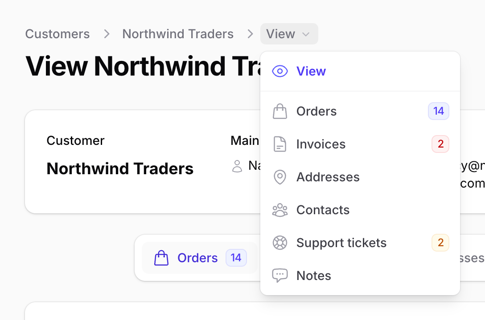
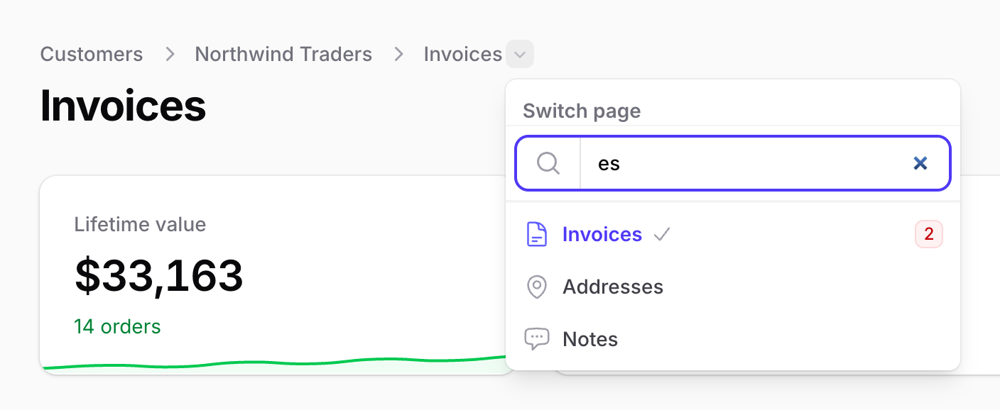

# Relation Navigator for Filament

<p class="filament-hidden">
    <a href="https://packagist.org/packages/wit3/filament-relation-navigator"></a>
    <a href="https://github.com/wit3/filament-relation-navigator/actions/workflows/tests.yml"></a>
    <a href="https://packagist.org/packages/wit3/filament-relation-navigator"></a>
    <a href="LICENSE.md"></a>
</p>

Give every relation manager of a Filament resource **its own page**, and jump
between them from a **menu in the breadcrumb**.

- `/customers/1?relation=orders` becomes **`/customers/1/orders`**: a real
  route you can link, bookmark and open in a new tab.
- The page renders the **relation manager you already have**: same table,
  filters, actions, badges and authorization. Nothing is duplicated.
- Add a **header** above the relation (the record's card, widgets, actions),
  taken from the resource.
- The last breadcrumb opens a **menu** with the record's pages and every
  relation the user can see, with icons and badges. Two looks, optional
  search and keyboard navigation, a view of your own, and a version for
  small screens.
- **One trait, no page classes**: no files to generate, nothing to add to
  `getPages()` or to the panel provider.

<picture>
    <source media="(prefers-color-scheme: dark)" srcset="https://raw.githubusercontent.com/wit3/filament-relation-navigator/main/art/relation-page-dark.png">
    
</picture>

## Requirements

| Package  | Version              |
| -------- | -------------------- |
| PHP      | 8.2+                 |
| Laravel  | 12, 13               |
| Filament | 4.x, 5.x             |

## Installation

```bash
composer require wit3/filament-relation-navigator
php artisan filament:assets
```

Run `filament:assets` again after each update: Filament copies the plugin's
stylesheet into `public/`.

## Quick start

**1. Give the relations a page.** Add the trait to the resource:

```php
use Wit3\FilamentRelationNavigator\Concerns\HasRelationPages;

class CustomerResource extends Resource
{
    use HasRelationPages;

    public static function getRelations(): array
    {
        return [
            'orders' => OrdersRelationManager::class,
            'invoices' => InvoicesRelationManager::class,
            NotesRelationManager::class,
        ];
    }
}
```

Every relation now has its page: `/customers/1/orders`, `/customers/1/invoices`,
`/customers/1/notes`.

**2. Add the menu to the view page:**

```php
use Wit3\FilamentRelationNavigator\Concerns\HasRelationNavigator;

class ViewCustomer extends ViewRecord
{
    use HasRelationNavigator;
}
```

That's all. The relation pages have the menu already, and the tabs on the
view page keep working as before.

<picture>
    <source media="(prefers-color-scheme: dark)" srcset="https://raw.githubusercontent.com/wit3/filament-relation-navigator/main/art/menu-simple-dark.png">
    
</picture>

## Relation pages

### Opting in

Opt in on the resource, for every relation manager, or only on the relation
managers you want:

```php
use Wit3\FilamentRelationNavigator\Concerns\InteractsWithRelationPage;

class OrdersRelationManager extends RelationManager
{
    use InteractsWithRelationPage;
}
```

| Setup                                       | Relations with a page               |
| ------------------------------------------- | ----------------------------------- |
| `HasRelationPages` on the resource          | all, minus the ones that opt out    |
| `InteractsWithRelationPage` on a manager    | only the managers that opt in       |
| A page class you wrote (see below)          | all, minus the ones that opt out    |

To leave some relations out:

```php
// On the resource
public static function hasRelationPage(string $slug): bool
{
    return $slug !== 'notes';
}

// On a relation manager, with InteractsWithRelationPage
protected static bool $hasRelationPage = false;
```

A relation manager shared by two resources opts in for both: use the
resource's `hasRelationPage()` to leave one of them out.

### URLs and slugs

| `getRelations()` entry                          | URL                         |
| ----------------------------------------------- | --------------------------- |
| `'orders' => OrdersRelationManager::class`      | `/customers/1/orders`       |
| `SupportTicketsRelationManager::class` (no key) | `/customers/1/support-tickets` |
| `RelationGroup::make('Activity', [...])`        | `/customers/1/activity`     |

The key in `getRelations()` wins; without a key, the slug is the kebab-cased
relationship name (or the group label). A relation manager can pick its own
with `protected static ?string $relationPageSlug = 'tickets';`. Slugs equal to
one of the resource's page keys (`edit`, `view`...) are skipped.

Each page is a named route, `relations.{slug}`:

```php
CustomerResource::getUrl('relations.orders', ['record' => $customer]);
```

### Authorization and behaviour

The relation manager receives the resource's **view** page as `$pageClass`
(the edit page when there is no view page), so `isReadOnly()`,
`canViewForRecord()`, `getBadge()` and every other check behave exactly as in
the tab. A relation page needs both the view page's `canAccess()` and the
manager's `canViewForRecord()`; an unknown slug is a 404.

## Header, actions and widgets

Above the relation, a relation page can show part of the record's view,
header actions and widgets. Define them on the resource for every relation
page, or on a relation manager for its own page:

```php
public static function relationPageHeader(Schema $schema): Schema
{
    // The whole infolist (static::infolist($schema)) or a piece of it.
    return $schema->components([
        CustomerCard::make(),
    ]);
}

public static function getRelationPageHeaderActions(): array
{
    return [
        Action::make('email')
            ->url(fn (Customer $record): string => "mailto:{$record->email}"),
    ];
}

public static function getRelationPageHeaderWidgets(): array
{
    return [CustomerStats::class]; // receives the record as $record
}

public static function getRelationPageFooterWidgets(): array
{
    return [];
}
```

- The header of a relation manager replaces the resource's one; actions and
  widgets of both are shown, the resource's first.
- Header actions act on the record the relation belongs to.
- With a header, the record's name is not repeated under the title.
- Pieces that only exist inside the view page class (its own methods and
  modals) are not reachable from here: move them to the resource, to an
  action class or to a trait.

## The breadcrumb menu

A record page is in the menu if, and only if, it uses `HasRelationNavigator`:
the view page, the edit page or any custom page of the record. On those pages
the last breadcrumb opens the menu. The relation pages are always listed,
after the record pages, with the relation managers' icons and badges, and
only when the user can see them.

If the page already builds its own breadcrumbs, pass them through
`withRelationNavigator()`:

```php
public function getBreadcrumbs(): array
{
    return $this->withRelationNavigator([
        CustomerResource::getUrl('index') => 'Customers',
        $this->getBreadcrumb(),
    ]);
}
```

A custom page that uses `InteractsWithRecord` itself, instead of extending
`ViewRecord` or `EditRecord`, has two `getBreadcrumbs()` methods. Unless it
defines its own, tell PHP which one wins:

```php
class CustomerActivity extends Page
{
    use HasRelationNavigator, InteractsWithRecord {
        HasRelationNavigator::getBreadcrumbs insteadof InteractsWithRecord;
        InteractsWithRecord::getBreadcrumbs as getRecordBreadcrumbs;
    }
}
```

The menu uses the page's `$navigationLabel` and `$navigationIcon`, and shows
it only when `canAccess()` allows it for the record.

## Menu presets

Publish the config:

```bash
php artisan vendor:publish --tag=filament-relation-navigator-config
```

```php
'menu' => [
    'preset' => 'simple',   // 'github', a preset of yours, or a view name
    'presets' => [
        'simple' => 'filament-relation-navigator::menu.simple',
        'github' => 'filament-relation-navigator::menu.github',
    ],
    'searchable' => false,  // a search field on top of the list, whatever the preset
    'search_from' => 0,     // ...from this many items
    'badges' => true,       // the relation managers' badges, as in their tabs
    'max_height' => '24rem',
    'separator' => true,    // record pages and relation pages in two blocks
    'mobile' => true,       // the menu above the heading on small screens
],
```

**simple**: the last breadcrumb itself opens the list (screenshot above).

**github**: the last breadcrumb stays text and a caret next to it opens a
panel with a heading and a check on the current page, like GitHub's
repository switcher. Here with `searchable` on: the field gets the focus when
the menu opens and Enter opens the first match.

**Keyboard**: from the search field, Down moves into the list; Up and Down
move between the pages, Enter opens one, Escape closes the menu.

<picture>
    <source media="(prefers-color-scheme: dark)" srcset="https://raw.githubusercontent.com/wit3/filament-relation-navigator/main/art/menu-github-search-dark.png">
    
</picture>

A page can override any of them:

```php
public function getRelationNavigatorPreset(): string
{
    return 'github';
}

public function isRelationNavigatorSearchable(): bool
{
    return true;
}

public function hasRelationNavigatorBadges(): bool
{
    return false; // the badges run the same queries as the tab badges
}
```

### Small screens

Filament hides the breadcrumbs below 40rem. There the menu shows above the
page heading instead, on every page that uses `HasRelationNavigator`, with
the same preset options. Turn it off with `'mobile' => false`, or per page:

```php
public function hasRelationNavigatorMobileMenu(): bool
{
    return false;
}
```

<picture>
    <source media="(prefers-color-scheme: dark)" srcset="https://raw.githubusercontent.com/wit3/filament-relation-navigator/main/art/mobile-dark.png">
    
</picture>

### Translations

English, Italian, Spanish, German, French, Brazilian Portuguese and Dutch.
Publish the translations to change them or add a language:

```bash
php artisan vendor:publish --tag=filament-relation-navigator-translations
```

### A preset of your own

Start from one of the package presets:

```bash
php artisan make:filament-relation-navigator-preset compact --from=github
```

It copies the preset to
`resources/views/filament/relation-navigator/compact.blade.php`. Register it
and change it as you like:

```php
'preset' => 'compact',
'presets' => [
    // ...
    'compact' => 'filament.relation-navigator.compact',
],
```

Any view name works as `preset` too. To change the package presets
themselves, publish their views:

```bash
php artisan vendor:publish --tag=filament-relation-navigator-views
```

A preset view receives:

| Variable             | Content                                                                 |
| -------------------- | ----------------------------------------------------------------------- |
| `$label`             | The last breadcrumb                                                     |
| `$items`             | The menu items: `key`, `label`, `url`, `icon`, `badge`, `badgeColor`, `isActive` |
| `$heading`           | "Switch page", translated                                               |
| `$isSearchable`      | Whether to show the search field                                        |
| `$hasSeparator`      | Whether to split record pages and relation pages in two blocks          |
| `$searchPlaceholder` | "Find a page…", translated                                              |
| `$emptyLabel`        | "No pages found.", translated                                           |
| `$maxHeight`         | `menu.max_height`                                                       |

Each item also has `isRelationPage()`. To reuse the search field, the list
(with the separator and the keyboard navigation) and the "no results" line,
include `filament-relation-navigator::menu.partials.list` with `showCheck`.

## Customising the relation pages

The generated relation pages cover most needs. To change their title, their
breadcrumbs or anything else a Filament page can do, write the page class
yourself; the package then uses yours for that resource:

```bash
php artisan make:filament-relation-navigator CustomerResource
```

```php
class CustomerRelationPage extends RelationPage
{
    protected static string $resource = CustomerResource::class;

    protected static ?array $relations = ['orders', 'invoices'];  // only these
    protected static array $excludedRelations = ['notes'];         // never these
}
```

```php
public static function getPages(): array
{
    return [
        'index' => ListCustomers::route('/'),
        'view' => ViewCustomer::route('/{record}'),
        ...CustomerRelationPage::relationRoutes(),
    ];
}
```

The class is a regular Filament page: override `getTitle()`,
`getBreadcrumbs()`, `getHeaderActions()`, use your own traits, and so on.

## Native record sub-navigation

The same items can feed Filament's record sub-navigation:

```php
public static function getRecordSubNavigation(Page $page): array
{
    return RelationNavigator::getRecordSubNavigation($page);
}
```

## How it works

- The routes are registered through Filament's own
  `Resource::registerRoutes()`, inside each resource's route group: slug,
  cluster, parent resource and tenant are handled by Filament.
- The page class of a resource is written on demand to
  `storage/framework/cache`, the way Laravel's real-time facades work, and
  registered with Livewire. It works with `route:cache`.
- The relation page embeds the relation manager as Filament does in the tabs,
  so its state, actions and modals stay in the relation manager.

## Testing

```bash
composer test        # the test suite
composer analyse     # PHPStan, level 8
composer format      # Pint
```

The suite runs on Filament 4 and 5, Laravel 12 and 13, PHP 8.2 to 8.5, and
covers nested resources, clusters, tenancy and SPA mode.

The browser tests (the searchable menu) need Playwright:

```bash
npm install && npx playwright install chromium
vendor/bin/testbench filament:assets
composer test:browser
```

## Changelog

See [CHANGELOG](CHANGELOG.md).

## Contributing

Issues and pull requests are welcome. Please run `composer test`,
`composer analyse` and `composer format` before opening a pull request.

## Security

Please report security issues privately through
[GitHub security advisories](https://github.com/wit3/filament-relation-navigator/security/advisories/new)
rather than in public issues.

## Credits

- [Salvatore Scalzi](https://github.com/wit3)
- [All contributors](https://github.com/wit3/filament-relation-navigator/contributors)

## License

The MIT License (MIT). See [LICENSE](LICENSE.md).
