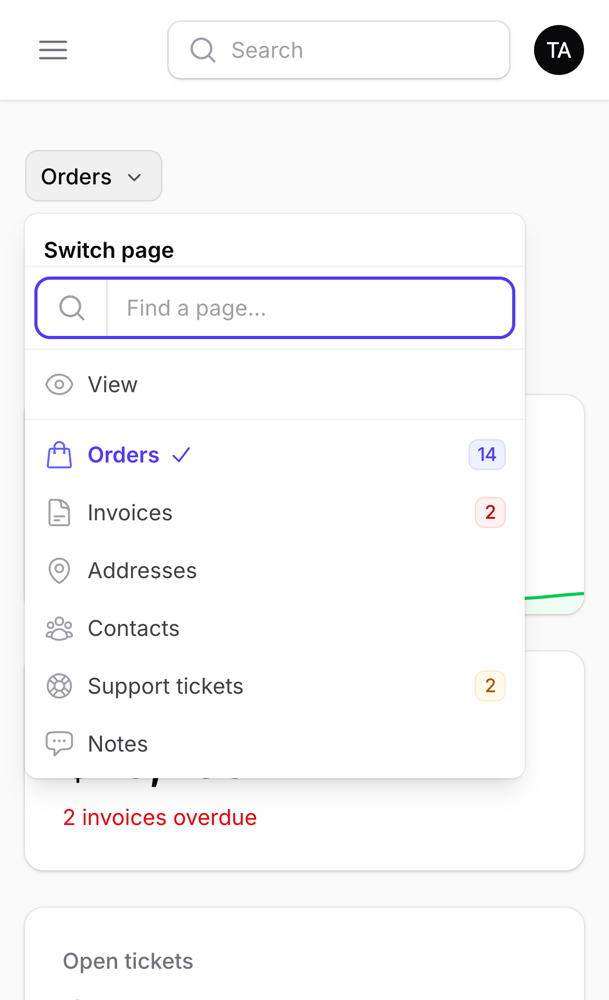

# Relation Navigator para Filament

<p class="filament-hidden">
    <a href="https://packagist.org/packages/wit3/filament-relation-navigator"></a>
    <a href="https://github.com/wit3/filament-relation-navigator/actions/workflows/tests.yml"></a>
    <a href="https://packagist.org/packages/wit3/filament-relation-navigator"></a>
    <a href="LICENSE.md"></a>
</p>

> **Documentação:** guias, configuração, atualizações e pesquisa em
> **[wit3.github.io/filament-relation-navigator/pt](https://wit3.github.io/filament-relation-navigator/pt/)**.
>
> **Última versão:** [](https://github.com/wit3/filament-relation-navigator/releases/latest) · [Novidades](https://wit3.github.io/filament-relation-navigator/pt/reference/changelog)
>
> **Em outros idiomas:** a documentação em
> [English](https://wit3.github.io/filament-relation-navigator/) (o original) · [Italiano](https://wit3.github.io/filament-relation-navigator/it/) · [Español](https://wit3.github.io/filament-relation-navigator/es/) · [Français](https://wit3.github.io/filament-relation-navigator/fr/) · [Deutsch](https://wit3.github.io/filament-relation-navigator/de/) · [中文](https://wit3.github.io/filament-relation-navigator/zh/) · [日本語](https://wit3.github.io/filament-relation-navigator/ja/) · [Русский](https://wit3.github.io/filament-relation-navigator/ru/) · [العربية](https://wit3.github.io/filament-relation-navigator/ar/).
> Cada idioma também tem seu README neste repositório (`README.md`, `README.it.md`...).

<!-- #region intro -->
Dê a cada relation manager de um resource do Filament **uma página só dele**,
e passe de um para outro com um **menu no breadcrumb**.

- `/customers/1?relation=orders` vira **`/customers/1/orders`**: uma rota
  de verdade, que você pode linkar, salvar nos favoritos e abrir em outra aba.
- A página mostra **o relation manager que você já tem**: mesma tabela,
  filtros, ações, badges e autorização. Nada é duplicado.
- Coloque um **cabeçalho** acima da relação (o card do registro, widgets,
  ações), vindo do resource.
- O último item do breadcrumb abre um **menu** com as páginas do registro e
  todas as relações que o usuário pode ver, com ícones e badges. Dois visuais,
  pesquisa e navegação por teclado opcionais, uma view sua e uma versão para
  telas pequenas.
- **Registro anterior e próximo** na mesma página, uma ação **"Abrir como
  página"** em cada tabela de relation manager e links para as abas antigas
  que levam às novas páginas: cada um pode ser ligado ou desligado no geral,
  por resource ou por página.
- **Um trait, nenhuma classe de página**: nenhum arquivo para gerar, nada para
  adicionar em `getPages()` ou no panel provider.
- **32 idiomas**, incluindo os da direita para a esquerda, com os códigos do
  Filament. A documentação está em 10.


<!-- #endregion intro -->

## Requisitos

<!-- #region requirements -->
| Pacote   | Versão               |
| -------- | -------------------- |
| PHP      | 8.2+                 |
| Laravel  | 12, 13               |
| Filament | 4.13+, 5.x           |
<!-- #endregion requirements -->

## Instalação

<!-- #region installation -->
```bash
composer require wit3/filament-relation-navigator
php artisan filament:assets
```

Rode `filament:assets` de novo depois de cada atualização: o Filament copia a
folha de estilo do plugin para `public/`.
<!-- #endregion installation -->

## Início rápido

<!-- #region quick-start -->
**1. Dê uma página às relações.** Adicione o trait ao resource:

```php
use Wit3\FilamentRelationNavigator\Concerns\HasRelationPages;

class CustomerResource extends Resource
{
    use HasRelationPages;

    public static function getRelations(): array
    {
        return [
            'orders' => OrdersRelationManager::class,
            'invoices' => InvoicesRelationManager::class,
            NotesRelationManager::class,
        ];
    }
}
```

Agora cada relação tem sua página: `/customers/1/orders`,
`/customers/1/invoices`, `/customers/1/notes`.

**2. Adicione o menu à página de visualização:**

```php
use Wit3\FilamentRelationNavigator\Concerns\HasRelationNavigator;

class ViewCustomer extends ViewRecord
{
    use HasRelationNavigator;
}
```

Pronto. As páginas das relações já têm o menu, e as abas da página de
visualização continuam funcionando como antes.

<picture>
    <source media="(prefers-color-scheme: dark)" srcset="https://raw.githubusercontent.com/wit3/filament-relation-navigator/main/art/relation-page-dark.png">
    
</picture>
<!-- #endregion quick-start -->

## Páginas das relações

<!-- #region relation-pages -->
### Como ativar

Ative no resource, para todos os relation managers, ou só nos relation
managers que você quiser:

```php
use Wit3\FilamentRelationNavigator\Concerns\InteractsWithRelationPage;

class OrdersRelationManager extends RelationManager
{
    use InteractsWithRelationPage;
}
```

| Configuração                                | Relações com uma página             |
| ------------------------------------------- | ----------------------------------- |
| `HasRelationPages` no resource              | todas, menos as excluídas           |
| `InteractsWithRelationPage` em um manager   | só os managers que usam o trait     |
| Uma classe de página sua (veja abaixo)      | todas, menos as excluídas           |

Para deixar algumas relações de fora:

```php
// No resource
public static function hasRelationPage(string $slug): bool
{
    return $slug !== 'notes';
}

// Em um relation manager, com InteractsWithRelationPage
protected static bool $hasRelationPage = false;
```

Um relation manager compartilhado por dois resources é ativado nos dois: use
o `hasRelationPage()` do resource para deixar um deles de fora.

### URLs e slugs

| Item de `getRelations()`                        | URL                         |
| ----------------------------------------------- | --------------------------- |
| `'orders' => OrdersRelationManager::class`      | `/customers/1/orders`       |
| `SupportTicketsRelationManager::class` (sem chave) | `/customers/1/support-tickets` |
| `RelationGroup::make('Activity', [...])`        | `/customers/1/activity`     |

Vale primeiro o slug do próprio relation manager
(`protected static ?string $relationPageSlug = 'tickets';`), depois a chave em
`getRelations()`, depois o nome da relação em kebab-case (ou o rótulo do
grupo: dê uma chave aos grupos, já que um rótulo traduzido muda com o idioma).
Slugs iguais a uma das chaves de página do resource (`edit`, `view`...) são
ignorados, assim como uma segunda relação com um slug já usado.

Cada página é uma rota nomeada, `relations.{slug}`:

```php
CustomerResource::getUrl('relations.orders', ['record' => $customer]);
```

### Autorização e comportamento

O relation manager recebe a página de **visualização** do resource como
`$pageClass` (a página de edição, quando não há página de visualização),
então `isReadOnly()`, `canViewForRecord()`, `getBadge()` e todas as outras
verificações funcionam exatamente como na aba. A página de visualização é
encontrada pela chave (`view`, `edit`, ou `$contextPage` em uma classe de
página sua) ou pela classe.

Uma página de relação exige o mesmo que a página de visualização (o
`canAccess()` dela e a policy `view` do registro; `update` quando ela
representa a página de edição) e o `canViewForRecord()` do manager. Sem
página de visualização ou de edição, vale a policy `view`. Uma policy que
nega como não encontrado dá 404, assim como um slug desconhecido. O menu, a
pesquisa global e "Abrir como página" só linkam as páginas que o usuário pode
abrir.

As páginas das relações não executam o código da própria página de
visualização: verificações no `authorizeAccess()` dela ou um
`getRelationManagers()` filtrado por usuário não valem ali. Coloque-as nas
policies, em `canViewForRecord()`, ou vete uma página de relação por registro
no resource:

```php
public static function canAccessRelationPage(Model $record, string $slug): bool
{
    return $slug !== 'audit-logs' || auth()->user()->isAdmin();
}
```
<!-- #endregion relation-pages -->

## Cabeçalho, ações e widgets

<!-- #region header-actions-and-widgets -->
Acima da relação, uma página de relação pode mostrar parte da visualização do
registro, ações de cabeçalho e widgets. Defina-os no resource para todas as
páginas de relação, ou em um relation manager para a página dele:

<picture>
    <source media="(prefers-color-scheme: dark)" srcset="https://raw.githubusercontent.com/wit3/filament-relation-navigator/main/art/relation-page-dark.png">
    
</picture>

```php
public static function relationPageHeader(Schema $schema): Schema
{
    // O infolist inteiro (static::infolist($schema)) ou uma parte dele.
    return $schema->components([
        CustomerCard::make(),
    ]);
}

public static function getRelationPageHeaderActions(): array
{
    return [
        Action::make('email')
            ->url(fn (Customer $record): string => "mailto:{$record->email}"),
    ];
}

public static function getRelationPageHeaderWidgets(): array
{
    return [CustomerStats::class]; // recebe o registro como $record
}

public static function getRelationPageFooterWidgets(): array
{
    return [];
}
```

- O cabeçalho de um relation manager substitui o do resource; as ações e os
  widgets dos dois aparecem juntos, primeiro os do resource.
- As ações de cabeçalho agem sobre o registro ao qual a relação pertence.
- Com um cabeçalho, o nome do registro não se repete embaixo do título.
- O que só existe dentro da classe da página de visualização (os métodos e
  modais dela) não pode ser acessado daqui: mova para o resource, para uma
  classe de ação ou para um trait.
<!-- #endregion header-actions-and-widgets -->

## O menu no breadcrumb

<!-- #region the-breadcrumb-menu -->
`HasRelationNavigator` precisa de uma página com um registro: `ViewRecord`,
`EditRecord` e as páginas que usam `InteractsWithRecord` já têm os dois
métodos que ele declara, `getRecord()` e `hasRecord()`. Em uma página sem
registro, o PHP avisa assim que a classe é carregada.

Uma página do registro está no menu se, e somente se, usa
`HasRelationNavigator`: a página de visualização, a de edição ou qualquer
página personalizada do registro. Nessas páginas o último item do breadcrumb
abre o menu. As páginas das relações sempre aparecem, depois das páginas do
registro, com os ícones e badges dos relation managers, e só quando o usuário
pode vê-las.

Se a página já monta os próprios breadcrumbs, passe-os por
`withRelationNavigator()`:

```php
public function getBreadcrumbs(): array
{
    return $this->withRelationNavigator([
        CustomerResource::getUrl('index') => 'Customers',
        $this->getBreadcrumb(),
    ]);
}
```

Uma página personalizada que usa `InteractsWithRecord` diretamente, em vez de
estender `ViewRecord` ou `EditRecord`, tem dois métodos `getBreadcrumbs()`.
A menos que ela defina o seu, diga ao PHP qual vale:

```php
class CustomerActivity extends Page
{
    use HasRelationNavigator, InteractsWithRecord {
        HasRelationNavigator::getBreadcrumbs insteadof InteractsWithRecord;
        InteractsWithRecord::getBreadcrumbs as getRecordBreadcrumbs;
    }
}
```

O menu usa `$navigationLabel` e `$navigationIcon` da página, e só a mostra
quando `canAccess()` permite para o registro.
<!-- #endregion the-breadcrumb-menu -->

## Abrir como página

<!-- #region open-as-page -->
Nas páginas de visualização e de edição, cada relation manager que tem sua
própria página ganha uma ação **Abrir como página** no cabeçalho da tabela,
ao lado do título e antes das ações dele. Ela abre a página do próprio
relation manager, ou a do seu grupo de relações quando ele não tem uma
própria. Na página de um grupo, os managers com página própria também ganham
a ação; na própria página, um manager nunca aponta para si mesmo.

<picture>
    <source media="(prefers-color-scheme: dark)" srcset="https://raw.githubusercontent.com/wit3/filament-relation-navigator/main/art/open-as-page-dark.png">
    
</picture>

Desligue onde precisar:

```php
// config/filament-relation-navigator.php: em todo lugar
'relation_manager_link' => false,
```

```php
// Em um resource: todos os seus relation managers
public static function hasRelationPageLinks(): bool
{
    return false;
}
```

```php
// Em um relation manager (com InteractsWithRelationPage)
protected static bool $hasRelationPageLink = false;

// ou, sem o trait
public static function hasRelationPageLink(): bool
{
    return false;
}
```

### A aparência

Por padrão é um link com uma seta. Mude na config:

```php
'relation_manager_action' => [
    'style' => 'button',        // link, button ou icon_button (o rótulo vira um tooltip)
    'label' => 'Página inteira', // texto ou chave de tradução; null: "Abrir como página", traduzido
    'icon' => 'heroicon-m-arrow-top-right-on-square', // qualquer ícone do Filament, ou null
    'icon_position' => 'after', // ou before
    'color' => 'gray',
    'size' => null,             // sm, md, lg...
    'new_tab' => false,
],
```

Ou mude a própria ação do Filament, em tudo menos a URL e quando ela aparece,
que o pacote define. Cada nível recebe a ação como o anterior a deixou:

```php
// Um service provider: todos os relation managers
RelationNavigator::configureRelationPageActionUsing(
    fn (Action $action, RelationManager $relationManager) => $action->outlined()->badge('novo'),
);
```

```php
// Um resource, ou um relation manager: só ali
public static function configureRelationPageAction(Action $action): Action
{
    return $action->iconButton()->tooltip('Abrir os pedidos na própria página');
}
```

`RelationNavigator::getRelationManagerPageUrl($relationManager)` retorna a
mesma URL, para um botão seu.
<!-- #endregion open-as-page -->

## Registro anterior e próximo

<!-- #region previous-and-next-record -->
Dois botões antes das ações de cabeçalho abrem o registro anterior ou o
próximo **na mesma página**: das faturas de um cliente para as faturas do
próximo cliente.


Um registro que não pode abrir essa página abre na primeira
página dele no menu. Eles vêm desligados por padrão, já que adicionam
algumas queries a cada renderização:

```php
'record_navigation' => true,
```

Eles seguem **a lista de onde o usuário veio**: a ordenação, os filtros, a
pesquisa e a aba, como na tela (até 100 registros; cerca de 30 com chaves UUID). Do primeiro ou do último registro
dessa lista não se vai além, em vez de pular para outra ordem. Um registro
que não está na lista (aberto por um link) segue a ordem das chaves. Para
seguir sempre a ordem das chaves:

```php
'record_navigation_follows_list' => false,
```

A lista só guarda seus registros quando a navegação entre registros está
ligada na config ou no resource (`hasRelationNavigatorRecordNavigation()`),
já que a página da lista não tem como perguntar a uma página do registro.

Eles percorrem a query do próprio resource (`getRecordRouteBindingEloquentQuery()`),
então tenancy e seus scopes valem, e pulam os registros que o usuário não pode
ver. Por página:

```php
public function hasRelationNavigatorRecordNavigation(): bool
{
    return true;
}

public function getRelationNavigatorRecordNavigationQuery(): ?Builder
{
    return Customer::query()->where('active', true);
}
```

Em um **resource aninhado**, eles ficam dentro do pai: de um pedido de um
cliente para o próximo pedido do mesmo cliente. Ali a lista é o relation
manager do pai: eles seguem a ordem dele quando o resource aninhado é o
related resource dele (`protected static ?string $relatedResource`), exceto
com o driver de sessão `cookie`, que guarda só a lista do pai.
<!-- #endregion previous-and-next-record -->

## Links para as abas dos relation managers

<!-- #region links-to-relation-manager-tabs -->
Quando as páginas das relações substituem as abas, links antigos como
`/customers/1?relation=orders` podem abrir `/customers/1/orders`:

```php
'redirect_relation_tabs' => true,
```

Abas sem página de relação, ou que o registro não pode ver, ficam onde
estão.
<!-- #endregion links-to-relation-manager-tabs -->

## Pesquisa global

<!-- #region global-search -->
Os resultados da pesquisa global podem levar direto às páginas das relações
do registro: pesquise um cliente, vá para os pedidos dele. Vem desligado por
padrão, já que executa o `canViewForRecord()` dos relation managers para cada
resultado:

<picture>
    <source media="(prefers-color-scheme: dark)" srcset="https://raw.githubusercontent.com/wit3/filament-relation-navigator/main/art/global-search-dark.png">
    
</picture>

```php
// config/filament-relation-navigator.php
'global_search_actions' => 3, // true para todos, ou o máximo de links por resultado
```

```php
// Em um resource: ligado ou desligado só para este resource
public static function hasRelationPageGlobalSearchActions(): bool
{
    return true;
}
```

```php
// Em um relation manager (com InteractsWithRelationPage): nunca linkado
protected static bool $hasRelationPageGlobalSearchAction = false;
```

Resources com `HasRelationPages` recebem os links sozinhos. Um resource que
já define `getGlobalSearchResultActions()`, ou que só é ativado pelos seus
relation managers, junta os links assim:

```php
public static function getGlobalSearchResultActions(Model $record): array
{
    return [
        // ...suas ações
        ...RelationNavigator::getGlobalSearchResultActions(static::class, $record),
    ];
}
```

Os links seguem as mesmas regras do menu: só as páginas de relação que o
usuário pode abrir.
<!-- #endregion global-search -->

## Presets do menu

<!-- #region menu-presets -->
Publique a config:

```bash
php artisan vendor:publish --tag=filament-relation-navigator-config
```

```php
'menu' => [
    'preset' => 'github',   // 'simple', um preset seu ou o nome de uma view
    'presets' => [
        'simple' => 'filament-relation-navigator::menu.simple',
        'github' => 'filament-relation-navigator::menu.github',
    ],
    'searchable' => true,   // um campo de pesquisa acima da lista, com qualquer preset
    'search_from' => 0,     // ...a partir desta quantidade de itens
    'badges' => 'lazy',     // os badges dos relation managers: 'lazy' quando o menu abre, true com a página, false desligados
    'max_height' => '24rem',
    'separator' => true,    // páginas do registro e páginas das relações em dois blocos
    'mobile' => true,       // o menu acima do título em telas pequenas
    'shortcut' => 'alt+shift+r', // abre o menu; null desliga
],
```

**github** (o padrão): o último item do breadcrumb continua sendo texto e uma
setinha ao lado abre um painel com um título, um campo de pesquisa e um check
na página atual, como o seletor de repositórios do GitHub. O campo recebe o
foco quando o menu abre e Enter abre o primeiro resultado.

**simple**: o próprio último item do breadcrumb abre a lista. Para o menu da
1.2 e anteriores, defina `'preset' => 'simple'` e `'searchable' => false`.

<picture>
    <source media="(prefers-color-scheme: dark)" srcset="https://raw.githubusercontent.com/wit3/filament-relation-navigator/main/art/menu-simple-dark.png">
    
</picture>

### Badges

O menu mostra os badges dos relation managers, como nas abas deles. Por
padrão eles são **carregados quando o menu abre**: até lá o menu está
fechado, então a página é renderizada sem as queries deles, também em cada
requisição do Livewire que redesenha os breadcrumbs. Um spinner aparece
durante o instante que eles levam.

```php
'badges' => 'lazy', // padrão; true: com a página; false: sem badges
```

Desligue onde precisar:

```php
// Uma página, ou um resource (static): sem badges neste menu
public function hasRelationNavigatorBadges(): bool
{
    return false;
}

// Um relation manager (com InteractsWithRelationPage): o badge dele fica na
// aba, não no menu
protected static bool $hasRelationNavigatorBadge = false;
```

Um relation manager cujo badge da aba é lazy no Filament
(`protected static ?bool $isBadgeLazyLoaded = true;`, ou `$isBadgeDeferred` no
Filament 4.13) também é lazy no menu, mesmo com `'badges' => true`.

Views do menu que não conseguem carregar os badges depois (views do pacote
publicadas antes da 1.3, ou presets seus que renderizam `$item->badge` por
conta própria) recebem os badges com a página, como antes: nada desaparece.

**Teclado**: no campo de pesquisa, a seta para baixo entra na lista; as setas
para cima e para baixo passam pelas páginas, Enter abre uma, Esc fecha o menu.

### Atalho e tooltip

<picture>
    <source media="(prefers-color-scheme: dark)" srcset="https://raw.githubusercontent.com/wit3/filament-relation-navigator/main/art/tooltip-dark.png">
    
</picture>

O botão que abre o menu tem um tooltip com o atalho, mostrado com as teclas
do Mac ou do Windows/Linux. O atalho abre o menu de qualquer ponto da página,
com o campo de pesquisa pronto, como o seletor de repositórios do GitHub:
<kbd>⌥</kbd> <kbd>⇧</kbd> <kbd>R</kbd> no Mac, <kbd>Alt</kbd> <kbd>Shift</kbd> <kbd>R</kbd>
nos outros sistemas. Mude na config ou por página:

```php
'shortcut' => 'mod+shift+p', // mod é ⌘ no Mac e Ctrl nos outros sistemas
```

```php
public function getRelationNavigatorShortcut(): ?string
{
    return null; // nenhum atalho nesta página
}
```

Ele foi feito para não atrapalhar:

- reconhece a tecla física, então funciona com qualquer layout de teclado e
  com Option no Mac (onde <kbd>⌥</kbd><kbd>⇧</kbd><kbd>R</kbd> digita ‰);
- não faz nada enquanto você digita em um campo;
- um atalho da pesquisa global do painel (`globalSearchKeyBindings()`) nunca
  é tomado: nesse caso o menu fica sem atalho;
- só o menu visível abre (breadcrumbs ou telas pequenas).

Teclas suportadas: `alt`, `shift`, `ctrl`, `meta`, `mod` mais uma letra, um
dígito ou `/ . , ;`.

<picture>
    <source media="(prefers-color-scheme: dark)" srcset="https://raw.githubusercontent.com/wit3/filament-relation-navigator/main/art/menu-github-search-dark.png">
    
</picture>

### Página, resource ou config

Cada opção tem três níveis. Vale primeiro a página, depois o resource, depois
a config:

| Método da página (static no resource) | Chave da config |
|---|---|
| `getRelationNavigatorPreset(): string` | `menu.preset` |
| `isRelationNavigatorSearchable(): bool` | `menu.searchable` |
| `hasRelationNavigatorBadges(): bool` | `menu.badges` |
| `hasDeferredRelationNavigatorBadges(): bool` | `menu.badges` = `'lazy'` |
| `getRelationNavigatorShortcut(): ?string` | `menu.shortcut` |
| `hasRelationNavigatorMobileMenu(): bool` | `menu.mobile` |
| `hasRelationNavigatorRecordNavigation(): bool` | `record_navigation` |
| `shouldRelationNavigatorRecordNavigationFollowList(): bool` | `record_navigation_follows_list` |
| `shouldRedirectRelationNavigatorTabs(): bool` | `redirect_relation_tabs` |

```php
// Em uma página
public function isRelationNavigatorSearchable(): bool
{
    return false;
}
```

```php
// Em um resource: o mesmo método, static, para todas as suas páginas
public static function hasRelationNavigatorRecordNavigation(): bool
{
    return true;
}
```

### Telas pequenas

O Filament esconde os breadcrumbs abaixo de 40rem. Nesse caso o menu aparece
acima do título da página, em toda página que usa `HasRelationNavigator`, com
as mesmas opções do preset. Desligue com `'mobile' => false`, ou por página:

```php
public function hasRelationNavigatorMobileMenu(): bool
{
    return false;
}
```

<picture>
    <source media="(prefers-color-scheme: dark)" srcset="https://raw.githubusercontent.com/wit3/filament-relation-navigator/main/art/mobile-dark.png">
    
</picture>

### Traduções

32 idiomas, com os mesmos códigos do Filament: alemão, árabe, búlgaro,
catalão, chinês (simplificado e tradicional), coreano, dinamarquês, eslovaco,
espanhol, finlandês, francês, grego, hebraico, holandês, húngaro, indonésio,
inglês, italiano, japonês, norueguês, persa, polonês, português (Portugal e
Brasil), romeno, russo, sueco, tcheco, turco, ucraniano e vietnamita. Nos
idiomas da direita para a esquerda, as setas de anterior e próximo se
invertem. Publique as traduções para mudá-las ou adicionar um idioma:

```bash
php artisan vendor:publish --tag=filament-relation-navigator-translations
```

### Um preset só seu

Comece de um dos presets do pacote:

```bash
php artisan make:filament-relation-navigator-preset compact --from=github
```

O comando copia o preset para
`resources/views/filament/relation-navigator/compact.blade.php`. Registre-o e
mude como quiser:

```php
'preset' => 'compact',
'presets' => [
    // ...
    'compact' => 'filament.relation-navigator.compact',
],
```

Qualquer nome de view também funciona como `preset`. Para mudar os próprios
presets do pacote, publique as views deles:

```bash
php artisan vendor:publish --tag=filament-relation-navigator-views
```

Uma view de preset recebe:

| Variável             | Conteúdo                                                                |
| -------------------- | ----------------------------------------------------------------------- |
| `$label`             | O último item do breadcrumb                                             |
| `$items`             | Os itens do menu: `key`, `label`, `url`, `icon`, `badge`, `badgeColor`, `isActive` |
| `$heading`           | "Switch page", traduzido                                                |
| `$isSearchable`      | Se o campo de pesquisa aparece                                          |
| `$hasSeparator`      | Se as páginas do registro e as das relações ficam em dois blocos        |
| `$shortcut`          | O atalho, ou null                                                       |
| `$shortcutKeys`      | As teclas do atalho a mostrar: `['mac' => [...], 'other' => [...]]`     |
| `$searchPlaceholder` | "Find a page…", traduzido                                               |
| `$emptyLabel`        | "No pages found.", traduzido                                            |
| `$maxHeight`         | `menu.max_height`                                                       |

Para dar ao seu botão o tooltip e o atalho, inclua
`filament-relation-navigator::menu.partials.trigger-attributes` dentro da tag
dele. Cada item também tem `isRelationPage()`. Para reaproveitar o campo de
pesquisa, a lista (com o separador e a navegação por teclado) e a linha de
"nenhum resultado", inclua `filament-relation-navigator::menu.partials.list`
com `showCheck`.
<!-- #endregion menu-presets -->

## Personalizar as páginas das relações

<!-- #region customising-the-relation-pages -->
### Título, subtítulo e breadcrumb de uma relação

Um relation manager pode defini-los para a própria página, a partir do
registro, sem classe de página:

```php
class OrdersRelationManager extends RelationManager
{
    public static function getRelationPageTitle(Model $ownerRecord): string|Htmlable|null
    {
        return "Pedidos de {$ownerRecord->name}";
    }

    public static function getRelationPageSubheading(Model $ownerRecord): string|Htmlable|null
    {
        return 'Últimos 12 meses';
    }

    public static function getRelationPageBreadcrumb(Model $ownerRecord): ?string
    {
        return 'Pedidos';
    }
}
```

Retorne `null` para manter o padrão. Uma classe de página sua (veja abaixo)
vale mais, com seus próprios `$title`, `$subheading` e `$breadcrumb`. O menu e
as abas mantêm o título do relation manager. Grupos de relações não têm
relation manager, então a página deles usa o rótulo do grupo.

### Uma classe de página sua

As páginas de relação geradas atendem à maioria dos casos. Para mudar o
título, os breadcrumbs ou qualquer outra coisa que uma página do Filament
faz, escreva você mesmo a classe da página; o pacote passa a usar a sua para
aquele resource:

```bash
php artisan make:filament-relation-navigator CustomerResource
```

```php
class CustomerRelationPage extends RelationPage
{
    protected static string $resource = CustomerResource::class;

    protected static ?array $relations = ['orders', 'invoices'];  // só estas
    protected static array $excludedRelations = ['notes'];         // nunca estas
}
```

```php
public static function getPages(): array
{
    return [
        'index' => ListCustomers::route('/'),
        'view' => ViewCustomer::route('/{record}'),
        ...CustomerRelationPage::relationRoutes(),
    ];
}
```

A classe é uma página normal do Filament: sobrescreva `getTitle()`,
`getBreadcrumbs()`, `getHeaderActions()`, use seus próprios traits, e assim
por diante.
<!-- #endregion customising-the-relation-pages -->

## Subnavegação nativa do registro

<!-- #region native-record-sub-navigation -->
Os mesmos itens podem alimentar a subnavegação de registro do Filament:

```php
public static function getRecordSubNavigation(Page $page): array
{
    return RelationNavigator::getRecordSubNavigation($page);
}
```
<!-- #endregion native-record-sub-navigation -->

## Como funciona

<!-- #region how-it-works -->
- As rotas são registradas pelo próprio `Resource::registerRoutes()` do
  Filament, dentro do grupo de rotas de cada resource: slug, cluster,
  resource pai e tenant ficam por conta do Filament.
- A classe de página de um resource é escrita sob demanda em
  `storage/framework/cache`, como funcionam as real-time facades do Laravel,
  e registrada no Livewire. Funciona com `route:cache`.
- A página de relação incorpora o relation manager como o Filament faz nas
  abas, então o estado, as ações e os modais continuam no relation manager.
<!-- #endregion how-it-works -->

## Agentes de IA

<!-- #region ai-agents -->
O pacote ensina os agentes de IA de programação a usá-lo, para que Claude
Code, Codex, Cursor, Copilot e similares escrevam os traits e as opções do
jeito certo:

- **Laravel Boost**: o pacote traz diretrizes e uma skill
  (`relation-navigator-development`). Escolha `wit3/filament-relation-navigator`
  quando rodar `php artisan boost:install` (ou `boost:update`).
- **llms.txt**: a documentação também é publicada para agentes, como
  índice ([llms.txt](https://wit3.github.io/filament-relation-navigator/llms.txt))
  e como arquivo único
  ([llms-full.txt](https://wit3.github.io/filament-relation-navigator/llms-full.txt)),
  em inglês. Cada página também tem uma versão em Markdown: adicione `.md` à
  URL dela.
- **Sem o Boost**: indique ao seu agente
  `vendor/wit3/filament-relation-navigator/resources/boost/skills/relation-navigator-development/SKILL.md`,
  por exemplo no seu `AGENTS.md` ou `CLAUDE.md`.
<!-- #endregion ai-agents -->

## Testes

<!-- #region testing -->
```bash
composer test        # a suíte de testes
composer analyse     # PHPStan, nível 8
composer format      # Pint
```

A suíte roda no Filament 4 e 5, Laravel 12 e 13, PHP 8.2 a 8.5, e cobre
resources aninhados, clusters, tenancy e modo SPA.

Os testes no navegador (o menu com pesquisa) precisam do Playwright:

```bash
npm install && npx playwright install chromium
vendor/bin/testbench filament:assets
composer test:browser
```
<!-- #endregion testing -->

## Changelog

<!-- #region changelog -->
Veja o [CHANGELOG](https://github.com/wit3/filament-relation-navigator/blob/main/CHANGELOG.md) (em inglês).
<!-- #endregion changelog -->

## Contribuir

<!-- #region contributing -->
Issues e pull requests são bem-vindos. Antes de abrir um pull request, rode
`composer test`, `composer analyse` e `composer format`.
<!-- #endregion contributing -->

## Segurança

<!-- #region security -->
Informe problemas de segurança em privado pelos
[GitHub security advisories](https://github.com/wit3/filament-relation-navigator/security/advisories/new),
e não em issues públicas.
<!-- #endregion security -->

## Créditos

<!-- #region credits -->
- [Salvatore Scalzi](https://github.com/wit3)
- [Todos os colaboradores](https://github.com/wit3/filament-relation-navigator/contributors)
<!-- #endregion credits -->

## Licença

<!-- #region license -->
Licença MIT. Veja a [LICENSE](https://github.com/wit3/filament-relation-navigator/blob/main/LICENSE.md).
<!-- #endregion license -->
