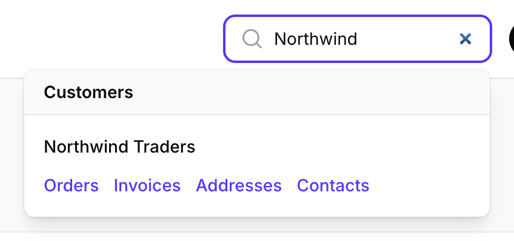

# Relation Navigator для Filament

<p class="filament-hidden">
    <a href="https://packagist.org/packages/wit3/filament-relation-navigator"></a>
    <a href="https://github.com/wit3/filament-relation-navigator/actions/workflows/tests.yml"></a>
    <a href="https://packagist.org/packages/wit3/filament-relation-navigator"></a>
    <a href="LICENSE.md"></a>
</p>

> **Документация:** руководства, справочник по настройке, руководство по обновлению и поиск на
> **[wit3.github.io/filament-relation-navigator/ru](https://wit3.github.io/filament-relation-navigator/ru/)**.
>
> **Последняя версия:** [Что нового](https://wit3.github.io/filament-relation-navigator/ru/reference/changelog) [](https://github.com/wit3/filament-relation-navigator/releases/latest)
>
> **На других языках:** документация на
> [English](https://wit3.github.io/filament-relation-navigator/) (оригинал) · [Italiano](https://wit3.github.io/filament-relation-navigator/it/) · [Español](https://wit3.github.io/filament-relation-navigator/es/) · [Português](https://wit3.github.io/filament-relation-navigator/pt/) · [Français](https://wit3.github.io/filament-relation-navigator/fr/) · [Deutsch](https://wit3.github.io/filament-relation-navigator/de/) · [中文](https://wit3.github.io/filament-relation-navigator/zh/) · [日本語](https://wit3.github.io/filament-relation-navigator/ja/) · [العربية](https://wit3.github.io/filament-relation-navigator/ar/).
> У каждого языка есть и свой README в этом репозитории (`README.md`, `README.it.md`...).

<!-- #region intro -->
Дайте каждому relation manager ресурса Filament **отдельную страницу** и
переходите между ними через **меню в хлебных крошках**.

- `/customers/1?relation=orders` становится **`/customers/1/orders`**: это
  настоящий маршрут, на него можно дать ссылку, добавить его в закладки и
  открыть в новой вкладке.
- Страница показывает **relation manager, который у вас уже есть**: та же
  таблица, фильтры, действия, бейджи и права доступа. Ничего не дублируется.
- Над связью можно показать **шапку** (карточку записи, виджеты, действия),
  она берётся из ресурса.
- Последний элемент хлебных крошек открывает **меню** со страницами записи и
  всеми связями, которые видит пользователь, с иконками и бейджами. Два
  варианта оформления, поиск и навигация с клавиатуры по желанию, своё
  представление и версия для маленьких экранов.
- **Предыдущая и следующая запись** на той же странице, действие **«Открыть
  как страницу»** в таблице каждого relation manager и старые ссылки на
  вкладки, которые ведут на новые страницы: каждую функцию можно включить
  или выключить глобально, для ресурса или для страницы.
- **Один трейт, никаких классов страниц**: не нужно ничего генерировать и
  ничего добавлять в `getPages()` или в panel provider.
- **32 языка**, включая языки с письмом справа налево, с кодами Filament.
  Документация доступна на 10 языках.


<!-- #endregion intro -->

## Требования

<!-- #region requirements -->
| Пакет    | Версия               |
| -------- | -------------------- |
| PHP      | 8.2+                 |
| Laravel  | 12, 13               |
| Filament | 4.13+, 5.x           |
<!-- #endregion requirements -->

## Установка

<!-- #region installation -->
```bash
composer require wit3/filament-relation-navigator
php artisan filament:assets
```

Запускайте `filament:assets` после каждого обновления: Filament копирует
таблицу стилей плагина в `public/`.
<!-- #endregion installation -->

## Быстрый старт

<!-- #region quick-start -->
**1. Дайте связям страницы.** Добавьте трейт в ресурс:

```php
use Wit3\FilamentRelationNavigator\Concerns\HasRelationPages;

class CustomerResource extends Resource
{
    use HasRelationPages;

    public static function getRelations(): array
    {
        return [
            'orders' => OrdersRelationManager::class,
            'invoices' => InvoicesRelationManager::class,
            NotesRelationManager::class,
        ];
    }
}
```

Теперь у каждой связи есть своя страница: `/customers/1/orders`,
`/customers/1/invoices`, `/customers/1/notes`.

**2. Добавьте меню на страницу просмотра:**

```php
use Wit3\FilamentRelationNavigator\Concerns\HasRelationNavigator;

class ViewCustomer extends ViewRecord
{
    use HasRelationNavigator;
}
```

Вот и всё. На страницах связей меню уже есть, а вкладки на странице
просмотра работают как раньше.

<picture>
    <source media="(prefers-color-scheme: dark)" srcset="https://raw.githubusercontent.com/wit3/filament-relation-navigator/main/art/relation-page-dark.png">
    
</picture>
<!-- #endregion quick-start -->

## Страницы связей

<!-- #region relation-pages -->
### Как включить

Включите страницы на ресурсе, для всех relation manager, или только в тех
relation manager, где они нужны:

```php
use Wit3\FilamentRelationNavigator\Concerns\InteractsWithRelationPage;

class OrdersRelationManager extends RelationManager
{
    use InteractsWithRelationPage;
}
```

| Настройка                                   | Связи со страницей                  |
| ------------------------------------------- | ----------------------------------- |
| `HasRelationPages` на ресурсе               | все, кроме исключённых              |
| `InteractsWithRelationPage` в менеджере     | только менеджеры с этим трейтом     |
| Свой класс страницы (см. ниже)              | все, кроме исключённых              |

Чтобы исключить некоторые связи:

```php
// На ресурсе
public static function hasRelationPage(string $slug): bool
{
    return $slug !== 'notes';
}

// В relation manager, с InteractsWithRelationPage
protected static bool $hasRelationPage = false;
```

Relation manager, общий для двух ресурсов, включается для обоих: чтобы
исключить один из них, используйте `hasRelationPage()` этого ресурса.

### URL и слаги

| Элемент `getRelations()`                        | URL                         |
| ----------------------------------------------- | --------------------------- |
| `'orders' => OrdersRelationManager::class`      | `/customers/1/orders`       |
| `SupportTicketsRelationManager::class` (без ключа) | `/customers/1/support-tickets` |
| `RelationGroup::make('Activity', [...])`        | `/customers/1/activity`     |

Приоритет у слага, заданного в самом relation manager
(`protected static ?string $relationPageSlug = 'tickets';`), затем идёт ключ в
`getRelations()`, затем имя связи в kebab-case (или подпись группы: давайте
группам ключ, потому что переведённая подпись меняется вместе с языком).
Слаги, совпадающие с ключом страницы ресурса (`edit`, `view`...),
пропускаются, как и вторая связь с уже занятым слагом.

Каждая страница — это именованный маршрут `relations.{slug}`:

```php
CustomerResource::getUrl('relations.orders', ['record' => $customer]);
```

### Права доступа и поведение

Relation manager получает в `$pageClass` страницу **просмотра** ресурса (или
страницу редактирования, если страницы просмотра нет), поэтому
`isReadOnly()`, `canViewForRecord()`, `getBadge()` и все остальные проверки
работают точно так же, как во вкладке. Страница просмотра ищется по ключу
(`view`, `edit` или `$contextPage` в вашем собственном классе страницы) или
по классу.

Странице связи нужно то же, что и странице просмотра (её `canAccess()` и
политика `view` для записи; `update`, когда она заменяет страницу
редактирования), плюс `canViewForRecord()` менеджера. Если нет ни страницы
просмотра, ни страницы редактирования, действует политика `view`. Политика,
которая отказывает «как не найдено», даёт 404, как и неизвестный слаг. Меню,
глобальный поиск и «Открыть как страницу» ведут только на страницы, которые
пользователь может открыть.

Страницы связей не выполняют собственный код страницы просмотра: проверки в
её `authorizeAccess()` или `getRelationManagers()` с фильтром по
пользователю там не действуют. Перенесите их в политики, в
`canViewForRecord()` или запретите страницу связи для конкретной записи на
ресурсе:

```php
public static function canAccessRelationPage(Model $record, string $slug): bool
{
    return $slug !== 'audit-logs' || auth()->user()->isAdmin();
}
```
<!-- #endregion relation-pages -->

## Шапка, действия и виджеты

<!-- #region header-actions-and-widgets -->
Над связью страница связи может показать часть просмотра записи, действия в
шапке и виджеты. Задайте их на ресурсе для всех страниц связей или в
relation manager для его собственной страницы:

<picture>
    <source media="(prefers-color-scheme: dark)" srcset="https://raw.githubusercontent.com/wit3/filament-relation-navigator/main/art/relation-page-dark.png">
    
</picture>

```php
public static function relationPageHeader(Schema $schema): Schema
{
    // Весь infolist (static::infolist($schema)) или его часть.
    return $schema->components([
        CustomerCard::make(),
    ]);
}

public static function getRelationPageHeaderActions(): array
{
    return [
        Action::make('email')
            ->url(fn (Customer $record): string => "mailto:{$record->email}"),
    ];
}

public static function getRelationPageHeaderWidgets(): array
{
    return [CustomerStats::class]; // получает запись как $record
}

public static function getRelationPageFooterWidgets(): array
{
    return [];
}
```

- Шапка relation manager заменяет шапку ресурса; действия и виджеты
  показываются и те и другие, сначала ресурса.
- Действия в шапке работают с записью, которой принадлежит связь.
- Если есть шапка, название записи не повторяется под заголовком.
- То, что существует только внутри класса страницы просмотра (её собственные
  методы и модальные окна), отсюда недоступно: перенесите это в ресурс, в
  класс действия или в трейт.
<!-- #endregion header-actions-and-widgets -->

## Меню в хлебных крошках

<!-- #region the-breadcrumb-menu -->
Трейту `HasRelationNavigator` нужна страница с записью: у `ViewRecord`,
`EditRecord` и страниц с `InteractsWithRecord` уже есть оба метода, которые
он объявляет, — `getRecord()` и `hasRecord()`. На странице без записи PHP
сообщит об этом сразу при загрузке класса.

Страница записи попадает в меню тогда и только тогда, когда она использует
`HasRelationNavigator`: страница просмотра, страница редактирования или любая
своя страница записи. На этих страницах последний элемент хлебных крошек
открывает меню. Страницы связей перечислены всегда, после страниц записи, с
иконками и бейджами relation manager, и только если пользователь может их
видеть.

Если страница уже сама строит хлебные крошки, передайте их через
`withRelationNavigator()`:

```php
/**
 * @return array<string | int, string | Htmlable>
 */
public function getBreadcrumbs(): array
{
    return $this->withRelationNavigator([
        CustomerResource::getUrl('index') => 'Customers',
        $this->getBreadcrumb(),
    ]);
}
```

У своей страницы, которая сама использует `InteractsWithRecord`, а не
наследует `ViewRecord` или `EditRecord`, два метода `getBreadcrumbs()`. Если
она не определяет свой, укажите PHP, какой из них главный:

```php
class CustomerActivity extends Page
{
    use HasRelationNavigator, InteractsWithRecord {
        HasRelationNavigator::getBreadcrumbs insteadof InteractsWithRecord;
        InteractsWithRecord::getBreadcrumbs as getRecordBreadcrumbs;
    }
}
```

Меню берёт `$navigationLabel` и `$navigationIcon` страницы и показывает её,
только если `canAccess()` разрешает это для записи.
<!-- #endregion the-breadcrumb-menu -->

## Открыть как страницу

<!-- #region open-as-page -->
На страницах просмотра и редактирования каждый relation manager, у которого
есть своя страница, получает действие **Открыть как страницу** в шапке
таблицы, рядом с заголовком и перед своими действиями. Оно открывает
страницу relation manager, а если её нет — страницу его группы связей. На
странице группы действие получают и менеджеры со своей страницей; на своей
странице менеджер никогда не ссылается сам на себя.

<picture>
    <source media="(prefers-color-scheme: dark)" srcset="https://raw.githubusercontent.com/wit3/filament-relation-navigator/main/art/open-as-page-dark.png">
    
</picture>

Отключите его там, где нужно:

```php
// config/filament-relation-navigator.php: везде
'relation_manager_link' => false,
```

```php
// На ресурсе: все его relation manager
public static function hasRelationPageLinks(): bool
{
    return false;
}
```

```php
// В relation manager (с InteractsWithRelationPage)
protected static bool $hasRelationPageLink = false;

// или без трейта
public static function hasRelationPageLink(): bool
{
    return false;
}
```

### Внешний вид

По умолчанию это ссылка со стрелкой. Измените её в конфиге:

```php
'relation_manager_action' => [
    'style' => 'button',        // link, button или icon_button (подпись становится подсказкой)
    'label' => 'Вся страница',  // текст или ключ перевода; null: «Открыть как страницу», с переводом
    'icon' => 'heroicon-m-arrow-top-right-on-square', // любая иконка Filament или null
    'icon_position' => 'after', // или before
    'color' => 'gray',
    'size' => null,             // sm, md, lg...
    'new_tab' => false,
],
```

Или измените само действие Filament — всё, кроме его URL и условия, когда
оно показывается: их задаёт пакет. Каждый уровень получает действие в том
виде, в каком его оставил предыдущий:

```php
// Service provider: все relation manager
RelationNavigator::configureRelationPageActionUsing(
    fn (Action $action, RelationManager $relationManager) => $action->outlined()->badge('новое'),
);
```

```php
// Ресурс или relation manager: только там
public static function configureRelationPageAction(Action $action): Action
{
    return $action->iconButton()->tooltip('Открыть заказы на отдельной странице');
}
```

`RelationNavigator::getRelationManagerPageUrl($relationManager)` возвращает
тот же URL, для вашей собственной кнопки.
<!-- #endregion open-as-page -->

## Предыдущая и следующая запись

<!-- #region previous-and-next-record -->
Две кнопки перед действиями в шапке открывают предыдущую или следующую
запись **на той же странице**: от счетов одного клиента к счетам следующего.


Запись, которая не может открыть эту страницу, открывается на своей первой
странице в меню. По умолчанию кнопки выключены, потому что добавляют
несколько запросов на каждый рендер:

```php
'record_navigation' => true,
```

Они следуют **списку, из которого пришёл пользователь**: его сортировке,
фильтрам, поиску и вкладке, как на экране (до 100 записей; около 30 с
ключами UUID). От первой или последней записи этого списка дальше идти
некуда: перехода к другому порядку не будет. Запись, которой нет в списке
(открытая по ссылке), идёт по порядку ключей. Чтобы всегда идти по порядку
ключей:

```php
'record_navigation_follows_list' => false,
```

Список запоминает свои записи, только когда навигация по записям включена в
конфиге или на ресурсе (`hasRelationNavigatorRecordNavigation()`), потому что
страница списка не может спросить страницу записи.

Они проходят по собственному запросу ресурса
(`getRecordRouteBindingEloquentQuery()`), поэтому тенанты и ваши скоупы
учитываются, а записи, которые пользователь не может просматривать,
пропускаются. Для отдельной страницы:

```php
public function hasRelationNavigatorRecordNavigation(): bool
{
    return true;
}

public function getRelationNavigatorRecordNavigationQuery(): ?Builder
{
    return Customer::query()->where('active', true);
}
```

На **вложенном ресурсе** они не выходят за пределы родителя: от одного
заказа клиента к следующему заказу того же клиента. Список там — это
relation manager родителя: кнопки следуют его порядку, если вложенный ресурс
является его related resource (`protected static ?string $relatedResource`),
кроме драйвера сессий `cookie`, который хранит только список родителя.
<!-- #endregion previous-and-next-record -->

## Ссылки на вкладки relation manager

<!-- #region links-to-relation-manager-tabs -->
Когда страницы связей заменяют вкладки, старые ссылки вида
`/customers/1?relation=orders` могут открывать `/customers/1/orders`:

```php
'redirect_relation_tabs' => true,
```

Вкладки без страницы связи или те, которые запись не может видеть, остаются
на месте.
<!-- #endregion links-to-relation-manager-tabs -->

## Глобальный поиск

<!-- #region global-search -->
Результаты глобального поиска могут вести прямо на страницы связей записи:
нашли клиента — перешли к его заказам. По умолчанию выключено, потому что
для каждого результата выполняется `canViewForRecord()` всех relation
manager:

<picture>
    <source media="(prefers-color-scheme: dark)" srcset="https://raw.githubusercontent.com/wit3/filament-relation-navigator/main/art/global-search-dark.png">
    
</picture>

```php
// config/filament-relation-navigator.php
'global_search_actions' => 3, // true для всех или наибольшее число ссылок на результат
```

```php
// На ресурсе: включить или выключить только для этого ресурса
public static function hasRelationPageGlobalSearchActions(): bool
{
    return true;
}
```

```php
// В relation manager (с InteractsWithRelationPage): никогда не показывать ссылку
protected static bool $hasRelationPageGlobalSearchAction = false;
```

Ресурсы с `HasRelationPages` получают ссылки сами. Ресурс, который сам
определяет `getGlobalSearchResultActions()` или включает страницы только
через свои relation manager, добавляет их так:

```php
public static function getGlobalSearchResultActions(Model $record): array
{
    return [
        // ...ваши действия
        ...RelationNavigator::getGlobalSearchResultActions(static::class, $record),
    ];
}
```

Для ссылок действуют те же правила, что и для меню: только страницы связей,
которые пользователь может открыть.
<!-- #endregion global-search -->

## Пресеты меню

<!-- #region menu-presets -->
Опубликуйте конфиг:

```bash
php artisan vendor:publish --tag=filament-relation-navigator-config
```

```php
'menu' => [
    'preset' => 'github',   // 'simple', ваш пресет или имя представления
    'presets' => [
        'simple' => 'filament-relation-navigator::menu.simple',
        'github' => 'filament-relation-navigator::menu.github',
    ],
    'searchable' => true,   // поле поиска над списком, с любым пресетом
    'search_from' => 0,     // ...начиная с этого числа элементов
    'badges' => 'lazy',     // бейджи relation manager: 'lazy' при открытии меню, true вместе со страницей, false выключены
    'max_height' => '24rem',
    'separator' => true,    // страницы записи и страницы связей двумя блоками
    'mobile' => true,       // меню над заголовком на маленьких экранах
    'shortcut' => 'alt+shift+r', // открывает меню; null отключает
],
```

**github** (по умолчанию): последний элемент хлебных крошек остаётся
текстом, а стрелка рядом с ним открывает панель с заголовком, полем поиска и
галочкой у текущей страницы, как переключатель репозиториев на GitHub. Поле
получает фокус при открытии меню, а Enter открывает первое совпадение.

**simple**: список открывает сам последний элемент хлебных крошек. Чтобы
вернуть меню версии 1.2 и более ранних, задайте `'preset' => 'simple'` и
`'searchable' => false`.

<picture>
    <source media="(prefers-color-scheme: dark)" srcset="https://raw.githubusercontent.com/wit3/filament-relation-navigator/main/art/menu-simple-dark.png">
    
</picture>

### Бейджи

Меню показывает бейджи relation manager, как в их вкладках. По умолчанию они
**загружаются при открытии меню**: до этого меню закрыто, поэтому страница
рендерится без их запросов, в том числе при каждом запросе Livewire, который
перерисовывает хлебные крошки. Пока они загружаются, виден спиннер.

```php
'badges' => 'lazy', // по умолчанию; true: вместе со страницей; false: без бейджей
```

Отключите их там, где нужно:

```php
// Страница или ресурс (static): без бейджей в этом меню
public function hasRelationNavigatorBadges(): bool
{
    return false;
}

// Relation manager (с InteractsWithRelationPage): его бейдж остаётся
// во вкладке, но не в меню
protected static bool $hasRelationNavigatorBadge = false;
```

Relation manager, у которого бейдж вкладки в Filament загружается лениво
(`protected static ?bool $isBadgeLazyLoaded = true;` или `$isBadgeDeferred` в
Filament 4.13), загружается лениво и в меню, даже с `'badges' => true`.

Представления меню, которые не умеют загружать бейджи позже (представления
пакета, опубликованные до 1.3, или ваши пресеты, которые сами выводят
`$item->badge`), получают их вместе со страницей, как раньше: ничего не
пропадает.

**Клавиатура**: из поля поиска стрелка вниз переводит в список; стрелки
вверх и вниз переключают страницы, Enter открывает страницу, Escape
закрывает меню.

### Сочетание клавиш и подсказка

<picture>
    <source media="(prefers-color-scheme: dark)" srcset="https://raw.githubusercontent.com/wit3/filament-relation-navigator/main/art/tooltip-dark.png">
    
</picture>

У кнопки, которая открывает меню, есть подсказка с сочетанием клавиш,
показанным клавишами Mac или Windows/Linux. Сочетание открывает меню из
любого места страницы, сразу с полем поиска, как переключатель репозиториев
на GitHub: <kbd>⌥</kbd> <kbd>⇧</kbd> <kbd>R</kbd> на Mac,
<kbd>Alt</kbd> <kbd>Shift</kbd> <kbd>R</kbd> в остальных системах. Измените
его в конфиге или для отдельной страницы:

```php
'shortcut' => 'mod+shift+p', // mod — это ⌘ на Mac и Ctrl в остальных системах
```

```php
public function getRelationNavigatorShortcut(): ?string
{
    return null; // на этой странице без сочетания клавиш
}
```

Оно сделано так, чтобы не мешать:

- оно привязано к физической клавише, поэтому работает с любой раскладкой и
  с Option на Mac (где <kbd>⌥</kbd><kbd>⇧</kbd><kbd>R</kbd> печатает ‰);
- оно ничего не делает, пока вы печатаете в поле;
- сочетание глобального поиска панели (`globalSearchKeyBindings()`) никогда
  не перехватывается: тогда у меню просто нет сочетания;
- открывается только видимое меню (в хлебных крошках или на маленьких
  экранах).

Поддерживаемые клавиши: `alt`, `shift`, `ctrl`, `meta`, `mod` плюс буква,
цифра или `/ . , ;`.

<picture>
    <source media="(prefers-color-scheme: dark)" srcset="https://raw.githubusercontent.com/wit3/filament-relation-navigator/main/art/menu-github-search-dark.png">
    
</picture>

### Страница, ресурс или конфиг

У каждой опции три уровня. Приоритет у страницы, затем у ресурса, затем у
конфига:

| Метод страницы (static на ресурсе) | Ключ конфига |
|---|---|
| `getRelationNavigatorPreset(): string` | `menu.preset` |
| `isRelationNavigatorSearchable(): bool` | `menu.searchable` |
| `hasRelationNavigatorBadges(): bool` | `menu.badges` |
| `hasDeferredRelationNavigatorBadges(): bool` | `menu.badges` = `'lazy'` |
| `getRelationNavigatorShortcut(): ?string` | `menu.shortcut` |
| `hasRelationNavigatorMobileMenu(): bool` | `menu.mobile` |
| `hasRelationNavigatorRecordNavigation(): bool` | `record_navigation` |
| `shouldRelationNavigatorRecordNavigationFollowList(): bool` | `record_navigation_follows_list` |
| `shouldRedirectRelationNavigatorTabs(): bool` | `redirect_relation_tabs` |

```php
// На одной странице
public function isRelationNavigatorSearchable(): bool
{
    return false;
}
```

```php
// На ресурсе: тот же метод, static, для всех его страниц
public static function hasRelationNavigatorRecordNavigation(): bool
{
    return true;
}
```

### Маленькие экраны

Filament скрывает хлебные крошки на экранах шириной меньше 40rem. Там меню показывается
над заголовком страницы, на каждой странице с `HasRelationNavigator`, с теми
же опциями пресета. Отключите его через `'mobile' => false` или для
отдельной страницы:

```php
public function hasRelationNavigatorMobileMenu(): bool
{
    return false;
}
```

<picture>
    <source media="(prefers-color-scheme: dark)" srcset="https://raw.githubusercontent.com/wit3/filament-relation-navigator/main/art/mobile-dark.png">
    
</picture>

### Переводы

32 языка, с теми же кодами, что и в Filament: английский, арабский,
болгарский, венгерский, вьетнамский, греческий, датский, иврит,
индонезийский, испанский, итальянский, каталанский, китайский (упрощённый и
традиционный), корейский, немецкий, нидерландский, норвежский, персидский,
польский, португальский (Португалия и Бразилия), румынский, русский,
словацкий, турецкий, украинский, финский, французский, чешский, шведский и
японский. В языках с письмом справа налево стрелки «назад» и «вперёд»
разворачиваются. Опубликуйте переводы, чтобы изменить их или добавить язык:

```bash
php artisan vendor:publish --tag=filament-relation-navigator-translations
```

### Свой пресет

Начните с одного из пресетов пакета:

```bash
php artisan make:filament-relation-navigator-preset compact --from=github
```

Команда копирует пресет в
`resources/views/filament/relation-navigator/compact.blade.php`.
Зарегистрируйте его и меняйте как угодно:

```php
'preset' => 'compact',
'presets' => [
    // ...
    'compact' => 'filament.relation-navigator.compact',
],
```

В `preset` можно указать и любое имя представления. Чтобы изменить сами
пресеты пакета, опубликуйте их представления:

```bash
php artisan vendor:publish --tag=filament-relation-navigator-views
```

Представление пресета получает:

| Переменная           | Содержимое                                                              |
| -------------------- | ----------------------------------------------------------------------- |
| `$label`             | Последний элемент хлебных крошек                                        |
| `$items`             | Элементы меню: `key`, `label`, `url`, `icon`, `badge`, `badgeColor`, `isActive` |
| `$heading`           | "Switch page", с переводом                                              |
| `$isSearchable`      | Показывать ли поле поиска                                               |
| `$hasSeparator`      | Делить ли страницы записи и страницы связей на два блока                |
| `$shortcut`          | Сочетание клавиш или null                                               |
| `$shortcutKeys`      | Клавиши для показа: `['mac' => [...], 'other' => [...]]`                |
| `$searchPlaceholder` | "Find a page…", с переводом                                             |
| `$emptyLabel`        | "No pages found.", с переводом                                          |
| `$maxHeight`         | `menu.max_height`                                                       |

Чтобы у вашей кнопки были подсказка и сочетание клавиш, подключите
`filament-relation-navigator::menu.partials.trigger-attributes` внутри её
тега. У каждого элемента есть ещё `isRelationPage()`. Чтобы повторно
использовать поле поиска, список (с разделителем и навигацией с клавиатуры)
и строку «ничего не найдено», подключите
`filament-relation-navigator::menu.partials.list` с `showCheck`.
<!-- #endregion menu-presets -->

## Настройка страниц связей

<!-- #region customising-the-relation-pages -->
### Заголовок, подзаголовок и хлебные крошки одной связи

Relation manager может задать их для своей страницы на основе записи, без
класса страницы:

```php
class OrdersRelationManager extends RelationManager
{
    public static function getRelationPageTitle(Model $ownerRecord): string|Htmlable|null
    {
        return "Заказы клиента {$ownerRecord->name}";
    }

    public static function getRelationPageSubheading(Model $ownerRecord): string|Htmlable|null
    {
        return 'Последние 12 месяцев';
    }

    public static function getRelationPageBreadcrumb(Model $ownerRecord): ?string
    {
        return 'Заказы';
    }
}
```

Верните `null`, чтобы оставить значение по умолчанию. Свой класс страницы
(см. ниже) имеет приоритет со своими `$title`, `$subheading` и
`$breadcrumb`. Меню и вкладки сохраняют заголовок relation manager. У групп
связей нет relation manager, поэтому их страница использует подпись группы.

### Свой класс страницы

Сгенерированных страниц связей хватает почти всегда. Чтобы изменить их
заголовок, хлебные крошки или что угодно ещё, что умеет страница Filament,
напишите класс страницы сами; тогда пакет будет использовать ваш класс для
этого ресурса:

```bash
php artisan make:filament-relation-navigator CustomerResource
```

```php
class CustomerRelationPage extends RelationPage
{
    protected static string $resource = CustomerResource::class;

    protected static ?array $relations = ['orders', 'invoices'];  // только эти
    protected static array $excludedRelations = ['notes'];         // никогда эти
}
```

```php
public static function getPages(): array
{
    return [
        'index' => ListCustomers::route('/'),
        'view' => ViewCustomer::route('/{record}'),
        ...CustomerRelationPage::relationRoutes(),
    ];
}
```

Это обычная страница Filament: переопределяйте `getTitle()`,
`getBreadcrumbs()`, `getHeaderActions()`, используйте свои трейты и так
далее.
<!-- #endregion customising-the-relation-pages -->

## Встроенная навигация по страницам записи

<!-- #region native-record-sub-navigation -->
Те же элементы можно передать во встроенную навигацию по страницам записи
в Filament (record sub-navigation):

```php
public static function getRecordSubNavigation(Page $page): array
{
    return RelationNavigator::getRecordSubNavigation($page);
}
```
<!-- #endregion native-record-sub-navigation -->

## Как это работает

<!-- #region how-it-works -->
- Маршруты регистрируются через собственный `Resource::registerRoutes()`
  Filament, внутри группы маршрутов каждого ресурса: слаг, кластер,
  родительский ресурс и тенант обрабатывает Filament.
- Класс страницы ресурса записывается по требованию в
  `storage/framework/cache`, так же как работают real-time фасады Laravel, и
  регистрируется в Livewire. Это работает с `route:cache`.
- Страница связи встраивает relation manager так же, как Filament делает это
  во вкладках, поэтому его состояние, действия и модальные окна остаются в
  relation manager.
<!-- #endregion how-it-works -->

## ИИ-агенты

<!-- #region ai-agents -->
Пакет объясняет ИИ-агентам для программирования, как им пользоваться,
поэтому Claude Code, Codex, Cursor, Copilot и подобные им правильно пишут
трейты и опции:

- **Laravel Boost**: пакет поставляется с рекомендациями (guidelines) и
  навыком (`relation-navigator-development`). Выберите
  `wit3/filament-relation-navigator`, когда запускаете
  `php artisan boost:install` (или `boost:update`).
- **llms.txt**: документация опубликована и для агентов, в виде
  оглавления ([llms.txt](https://wit3.github.io/filament-relation-navigator/llms.txt))
  и одним файлом
  ([llms-full.txt](https://wit3.github.io/filament-relation-navigator/llms-full.txt)),
  на английском. У каждой страницы есть и версия в Markdown: добавьте `.md`
  к её URL.
- **Без Boost**: укажите агенту на
  `vendor/wit3/filament-relation-navigator/resources/boost/skills/relation-navigator-development/SKILL.md`,
  например из вашего `AGENTS.md` или `CLAUDE.md`.
<!-- #endregion ai-agents -->

## Тесты

<!-- #region testing -->
```bash
composer test        # набор тестов
composer analyse     # PHPStan, уровень 8
composer format      # Pint
```

Тесты запускаются на Filament 4 и 5, Laravel 12 и 13, PHP с 8.2 по 8.5 и
покрывают вложенные ресурсы, кластеры, мультитенантность и режим SPA.

Браузерным тестам (меню с поиском) нужен Playwright:

```bash
npm install && npx playwright install chromium
vendor/bin/testbench filament:assets
composer test:browser
```
<!-- #endregion testing -->

## Список изменений

<!-- #region changelog -->
См. [CHANGELOG](https://github.com/wit3/filament-relation-navigator/blob/main/CHANGELOG.md) (на английском).
<!-- #endregion changelog -->

## Участие в разработке

<!-- #region contributing -->
Issues и pull requests приветствуются. Перед тем как открыть pull request,
запустите `composer test`, `composer analyse` и `composer format`.
<!-- #endregion contributing -->

## Безопасность

<!-- #region security -->
Сообщайте о проблемах безопасности конфиденциально через
[GitHub security advisories](https://github.com/wit3/filament-relation-navigator/security/advisories/new),
а не в публичных issues.
<!-- #endregion security -->

## Авторы

<!-- #region credits -->
- [Salvatore Scalzi](https://github.com/wit3)
- [Все участники](https://github.com/wit3/filament-relation-navigator/contributors)
<!-- #endregion credits -->

## Лицензия

<!-- #region license -->
Лицензия MIT. См. [LICENSE](https://github.com/wit3/filament-relation-navigator/blob/main/LICENSE.md).
<!-- #endregion license -->
